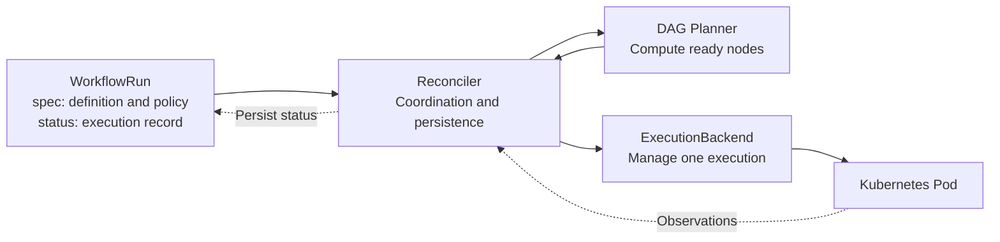

# Milos

English | [Chinese (Simplified)](README.zh-CN.md)

**A Kubernetes-native machine learning workflow engine for heterogeneous CPU and GPU clusters.**

Milos aims to improve scheduling and resource allocation for machine learning training and inference on heterogeneous Kubernetes clusters, matching each workflow stage to the CPU, GPU, and other resources it needs.

The project starts with a reliable Pod workflow execution core. The current core accepts native `WorkflowRun` resources and advances DAGs through level-triggered reconciliation. A focused Argo Workflow YAML importer is planned. The default path uses native Pods and `default-scheduler` in a single cluster. Experimental optional adapters now integrate Kueue, MultiKueue, and Volcano, providing a foundation for resource and scheduling policies tailored to machine learning workloads.

The name comes from the Mediterranean island of Milos.

> Prototype stage: the Go controller, WorkflowRun CRD, DAG planner, native Pod backend, and tests are implemented. Optional Kueue, MultiKueue and Volcano adapters are implemented. Argo import, application retries, Helm packaging and ML placement policies remain planned. This is not a production release; real workload and cluster E2E validation is still required.

## Project description

Milos is a Kubernetes-native workflow engine being developed to improve scheduling and resource allocation for machine learning training and inference across heterogeneous CPU and GPU clusters. It uses level-triggered reconciliation to execute Pod DAGs, with optional Kueue admission, MultiKueue placement and Volcano scheduling integrations. A focused Argo Workflow YAML importer and ML resource optimization policies are planned.

## Repository

Source: [github.com/wsq2333/milos](https://github.com/wsq2333/milos).

```sh
git clone https://github.com/wsq2333/milos.git
cd milos
```

Start with the [architecture design](docs/design.md) and [execution abstraction](docs/execution-abstraction.md). The Go module is `github.com/wsq2333/milos`. See [development and local execution](docs/development.md) for build commands, CRD installation, and the implementation boundary.

## Goals

The long-term direction follows the practical needs of training and inference:

- **Match workloads to heterogeneous resources.** Distinguish CPU data processing, GPU training, and inference stages, and explore allocation based on device type, device memory, resource requirements, and data location.
- **Improve scheduling at the workflow level.** Account for dependencies, parallelism, and resource availability to reduce queueing, idle capacity, and GPU fragmentation while improving workflow completion times.
- **Allocate resources across shared clusters.** Use optional admission and scheduling integrations to support queues, fair sharing, priorities, and execution across clusters.
- **Measure improvements.** Compare against the default scheduling path using queueing time, end-to-end completion time, CPU/GPU utilization, inference throughput, and resource cost. Choose policies based on workload measurements.

These are research and development goals. The first release does not implement a custom node scheduling algorithm, automatic GPU selection, or multi-Pod distributed training. Training and batch inference can initially be modeled as finite Pod DAGs. Long-running online inference, autoscaling, and latency objectives require a separate future design.

The first release establishes reliable execution: read persistent state, compute the next step, perform idempotent actions, and converge. Each workflow node maps to a Pod, and successors run only after all predecessors succeed.

Milos implements workflow progression itself. It does not run the Argo Controller or Argo executor. Argo YAML is an input format; a dedicated `WorkflowRun` CRD stores active execution state. The first release does not depend on PostgreSQL, a message broker, or callbacks from application containers.

The core acceptance criterion is recovery from controller restarts at any step using only persistent objects. Repeated reconciliation must not create a second task for the same execution identity or overlook an eligible successor. Applications remain responsible for idempotent side effects under cross-cluster failures.

## First-release target scope

| Capability | Planned scope |
| --- | --- |
| Input | `Workflow` with one entrypoint DAG and all templates defined in the same document |
| Dependencies | `dag.tasks` and `dependencies`; all predecessors must succeed |
| Execution | `container` templates; one Pod with one application container per node attempt |
| Parameters | Workflow/input string parameters, bound at submission |
| Pod configuration | Explicit allowlist for images, commands, environment variables, resources, volumes, and related fields |
| Failure handling | Skip descendants of failed nodes; continue independent branches; require explicit `dag.failFast: false` |
| Lifecycle | Persistent cancellation intent, workflow timeouts, and bounded application-failure retries |
| Scheduling | Native Pods with default-scheduler in one cluster; no Kueue or Volcano installation required |
| State | Pod status supplies execution facts; WorkflowRun status stores confirmed results |

The first release excludes `steps`, nested DAGs, loops, `when`, enhanced `depends`, output parameters, artifacts, script templates, sidecars, hooks, synchronization locks, WorkflowTemplate references, and multi-Pod gangs. Ordinary parallel nodes are handled independently; the entire DAG is not a gang.

Unsupported execution fields must produce errors rather than being silently discarded. See the [Argo input contract](docs/argo-subset.md) for the field allowlist, parameter scopes, and compatibility boundaries.

## Architecture



| Component | Responsibility |
| --- | --- |
| Milos | DAG progression, execution identity, application retries, node results, cancellation, and cleanup coordination |
| Kubernetes | API persistence, Pod lifecycle, and container execution facts |
| Kueue (optional) | Queues, quota, resource admission, and quota-level preemption |
| MultiKueue (optional) | Worker selection, remote task management, and status synchronization |
| Volcano (optional) | Node scheduling in the execution cluster; device capabilities depend on plugins and deployment configuration |

NativePodBackend handles the default local path; a router selects the scheduled Pod adapter for optional integrations. The DAG planner consumes normalized execution results without depending on queue or scheduler types. ExecutionBackend covers Ensure, Observe, Stop, and Collect; see the [execution abstraction](docs/execution-abstraction.md).

In the experimental multi-cluster mode, WorkflowRun stays on the manager. Milos creates a manager Pod and delegates remote Pod management to MultiKueue, rather than implementing a competing remote submitter. Single-cluster mode observes the actual execution Pod directly.

Milos reads worker Pods directly before accepting remote results, and waits for worker resource absence during cancellation. Manager-mirrored status alone is insufficient. Worker disconnection blocks confirmation. These checks do not provide distributed fencing or exactly-once side effects. See [scheduling integrations](docs/scheduling-integrations.md) for configuration, permissions and validation limits.

Supported modes are native/default, native/Volcano, local Kueue/default, local Kueue/Volcano, and MultiKueue/default. MultiKueue/Volcano and multi-Pod gangs are rejected. Optional flags default to disabled; Kueue v1beta2 and Volcano v1beta1 APIs are required.

## State progression

```text
Read WorkflowRun and observe resources through the backend (Pods and optional scheduling resources)
→ Validate ownership, current attempt, and resource UID
→ Normalize current observations
→ Persist node results and the next execution intent
→ Idempotently create or clean up resources
→ Read again and converge
```

Watch events enqueue reconciliation; they do not directly start successors. Startup recovery, resource watches, and periodic checks of active workflows drive progress. The in-memory queue is not an execution ledger.

Pod success must be persisted before successors can start or Milos-managed garbage collection can remove the Pod. Disconnection, Unknown status, and missing resources require investigation rather than immediate re-execution. Acceptance of a cancellation request and confirmation that remote execution has stopped are recorded separately.

## Input example

[diamond.yaml](examples/diamond.yaml) defines the following dependencies and invokes the same template from multiple tasks:

```text
    prepare
    /     \
  left   right
    \     /
     finish
```

This is an input example for the future importer; Milos cannot execute it yet. The planned import path is: validate Argo YAML, compile an immutable definition, then create a WorkflowRun. Applying the file directly with `kubectl apply` targets an Argo Workflow, not a Milos WorkflowRun.

## Implemented core and Go dependencies

```text
milos/
├── cmd/controller/          # Namespace-scoped controller manager
├── api/v1alpha1/            # WorkflowRun API and generated deep-copy methods
├── internal/
│   ├── workflow/            # Pure DAG validation and planner
│   ├── controller/          # Persisted decisions, reconciliation, cancellation
│   ├── execution/           # Ensure / Observe / Stop / Collect contract
│   ├── backends/            # Native backend, scheduling adapter and router
│   └── pod/                 # Stable execution identity and ownership checks
├── config/{crd,rbac,samples}/
├── deploy/                  # Deployment, image build and optional overlays
├── tests/integration/       # Isolated API server tests
├── examples/                # Planned Argo importer inputs
└── docs/
```

| Dependency | Pinned version |
| --- | --- |
| Go language/toolchain minimum | 1.26.0 |
| controller-runtime | v0.24.0 |
| Kubernetes api / apimachinery / client-go | v0.36.0 |
| controller-gen | v0.21.0 |

Runtime module checksums are recorded in `go.sum`. The code generator is version-pinned in the Makefile and runs in a separate Go tool module context.

```sh
go mod download
make build test vet
make generate manifests
make test-integration
```

The native [WorkflowRun diamond example](config/samples/diamond.yaml) is the current controller input. Implemented behavior includes dependency progression, bounded parallelism, independent-branch continuation, cancellation, workflow deadlines, stable Pod identity, and deletion cleanup. Creation intent is persisted before creating a Pod; terminal results are persisted before enabling successors. `maxRetries` must be zero. Finished Pods are retained until active-run cancellation or WorkflowRun deletion; automatic result collection is not yet wired into reconciliation.

The integration target starts its own API server and etcd, downloading Kubernetes 1.36.0 test binaries if needed. It does not run containers or use your current cluster. See [development instructions](docs/development.md) before starting the controller against a cluster.

## Roadmap

1. **Single-cluster core:** NativePodBackend with default-scheduler, strict import, a diamond DAG, failure propagation, and restart recovery.
2. **Lifecycle:** application retries, timeouts, cancellation, result retention, and cleanup.
3. **Local integrations:** harden the implemented Kueue and Volcano adapters with real scheduler acceptance tests.
4. **Multiple clusters:** validate the experimental MultiKueue/default-scheduler adapter with real dispatch, disconnection and remote cancellation; design Volcano combinations separately.
5. **Scale and extensions:** use measurements to decide whether to split out node CRs, introduce execution groups, or expand the YAML subset.
6. **ML workload optimization:** establish training and batch-inference benchmarks; explore heterogeneous resource matching, workflow concurrency policies, GPU utilization, and resource cost. Design online inference support separately as needed.

Each stage has independent acceptance criteria. Third-party integrations do not block the first release. Future multi-cluster support requires proven terminal-result retention and remote cleanup, not just evidence that a remote Pod can run.

## Design documents

- [Deployment configuration](deploy/README.md): Dockerfile, Kustomize overlays, permissions, installation and cleanup procedures. Deployment and live verification await explicit instruction.
- [Scheduling integrations](docs/scheduling-integrations.md): supported combinations, sample configurations, optional RBAC and acceptance boundaries.
- [Development and local execution](docs/development.md): implemented scope, commands, API behavior, and validation boundaries.
- [Architecture and execution protocol](docs/design.md): state authority, reconciliation order, retries, cancellation, module boundaries, acceptance cases, and open questions.
- [Execution abstraction](docs/execution-abstraction.md): the native Pod baseline, lifecycle interfaces, optional dependencies, and backend extensions.
- [Argo input contract](docs/argo-subset.md): supported fields, rejection rules, and semantic differences.

## Documentation language

All new or updated documentation and code comments must use English. [README.zh-CN.md](README.zh-CN.md) is the explicitly maintained Chinese translation; keep it aligned with the English README. Repository instructions are recorded in [AGENTS.md](AGENTS.md).
