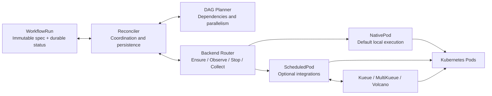
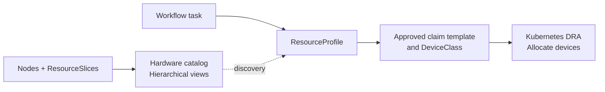

# Milos

English | [Chinese (Simplified)](README.zh-CN.md)

**A Kubernetes-native machine learning workflow engine for heterogeneous CPU and GPU clusters.**

Milos aims to improve scheduling and resource allocation for training and inference workflows: match stages to suitable resources, reduce queueing and idle capacity, and improve workflow completion time and resource efficiency.

The current implementation executes finite Pod DAGs from native `WorkflowRun` resources, with dependency tracking, bounded parallelism, cancellation, workflow/node deadlines, node runtime limits, waiting diagnostics and restart recovery. Native Pods with `default-scheduler` are the default; Kueue, MultiKueue and Volcano integrations are optional and experimental. ML allocation policies, distributed training workloads and online inference support remain future work.

> Prototype: unit and isolated API tests pass. Small CPU DAGs and cancellation have been validated with Kueue and Volcano in a shared cluster. GPU, MultiKueue and production-scale acceptance remain pending.

## Key features

| Feature | Status | What it provides |
| --- | --- | --- |
| Workflow orchestration | Implemented | Finite Pod DAGs with dependency tracking and bounded parallelism |
| Argo-style authoring | Implemented subset | Strict Milos YAML compiled into WorkflowRun; standard Argo import remains planned |
| ResourceProfile catalog and constraints | Implemented, native/default | List profiles, inspect guidance and bounds, and enforce Pod selectors, tolerations and resource checks |
| Restart-safe execution | Implemented | Persist execution decisions and identities before creating resources |
| Execution controls and diagnostics | Implemented | Cancellation, workflow/node timeouts and visible waiting reasons |
| Scheduling adapters | Experimental | Kueue admission, Volcano placement and MultiKueue/default remote execution |
| DRA-backed profiles and hardware views | Planned | Approved device claims, driver-owned inventory and lightweight hierarchical catalogs |
| Distributed topology and networking | Planned | Execution groups, local TAS then worker-side TAS/DRA, and network-device requirements; Volcano is an alternative |
| Measured resource optimization | Planned | Hardware recommendations, then constrained selection based on completion time, cost and fairness |

Planned features are design goals, not current capabilities. See the [roadmap](#roadmap) and [DRA/TAS design](docs/resource-pools.md) for delivery and acceptance criteria.

## Core architecture



- **Workflow core:** the planner computes ready nodes without knowing queue or scheduler types. The reconciler persists execution intent before creation and terminal results before starting successors.
- **Execution layer:** backends share Pod identity and lifecycle helpers. Kueue owns admission, MultiKueue owns remote dispatch, and Volcano owns node scheduling. Milos observes worker resources directly before accepting remote results or confirming cleanup.
- **Persistent state:** `WorkflowRun.spec` stores immutable inputs; `status` stores node results and resource identities. Kubernetes APIs hold active state; no external database is required.

Supported combinations are native/default, native/Volcano, Kueue/default, Kueue/Volcano and MultiKueue/default. Each node currently represents one Pod; MultiKueue/Volcano and multi-Pod gangs are unsupported. Automatic retries and result collection are not enabled, and cross-cluster exactly-once execution is not guaranteed.

## Code structure

```text
milos/
├── api/v1alpha1/             # WorkflowRun / ResourceProfile APIs and generated types
├── cmd/
│   ├── controller/          # Controller manager, integration flags and worker clients
│   └── milos/               # Authoring compiler CLI and profile catalog commands
├── internal/
│   ├── authoring/           # Strict Milos Workflow-to-WorkflowRun compiler
│   ├── catalog/             # Read-only profile discovery and display
│   ├── resources/           # Profile validation, resolution and snapshot digests
│   ├── workflow/            # Pure DAG validation and planner
│   ├── controller/          # Reconciliation, durable decisions and node timeouts
│   ├── execution/           # Backend lifecycle contract and configuration validation
│   ├── backends/
│   │   ├── router.go        # Select the execution path
│   │   ├── nativepod/       # Default local Pod backend
│   │   └── scheduledpod/    # Kueue, MultiKueue and Volcano adapters
│   └── pod/                 # Shared Pod lifecycle, identity and ownership checks
├── config/
│   ├── crd/                # Generated CRD schemas and Kustomize entrypoint
│   ├── rbac/               # Generated roles, service account and base binding
│   └── samples/            # Native WorkflowRun and timeout examples
├── deploy/
│   ├── Dockerfile          # Controller image build
│   ├── base/               # Namespace and controller deployment
│   ├── crds/               # CRD installation entrypoint
│   ├── overlays/           # Native and optional scheduling deployment modes
│   ├── rbac/               # Optional integration bindings and worker reader role
│   └── sim-prod/           # Dedicated smoke-test deployment rendering and guide
├── examples/
│   ├── diamond.yaml        # Input for the planned standard Argo importer
│   └── milos/              # Implemented authoring, ResourceProfile and catalog RBAC examples
├── example/                # Cluster smoke-test DAGs, Argo baseline and verification script
├── tests/
│   ├── integration/        # Isolated API-server contract and recovery tests
│   └── live/               # Opt-in real-cluster scheduling tests
├── docs/                   # Architecture, authoring, extensions and operational guides
├── Makefile                # Build, generation, lint and test entrypoints
├── go.mod / go.sum         # Go module and dependency checksums
└── AGENTS.md               # Repository contribution instructions
```

The implementation uses Go 1.26+, controller-runtime and client-go. External scheduling resources use unstructured clients, without importing upstream controller implementations. Start with the [native WorkflowRun example](config/samples/diamond.yaml) or the [Milos authoring example](examples/milos/profile-workflow.yaml). Standard Argo YAML import is not implemented yet; the strict Milos-owned authoring compiler is available.

Unit tests live beside their packages as `*_test.go`; `tests/` contains API and live integration tests. `make build` produces the ignored `bin/milos` and `bin/milos-controller` binaries. The two example directories currently serve different purposes: `examples/` contains authoring/profile inputs, while [example/](example/README.md) contains cluster smoke-test workloads and verification tooling.

## Resource-aware authoring

The first native-Pod profile path is implemented. Write a Milos-owned Argo-style Workflow with optional task `milos.requirements.profileRef`, compile it locally, and explicitly create the resulting WorkflowRun:

```sh
make build
bin/milos --file examples/milos/profile-workflow.yaml --namespace YOUR_NAMESPACE > /tmp/workflowrun.yaml
# After an administrator installs the CRDs/controller and a verified profile:
kubectl --context YOUR_CONTEXT create --validate=strict -f /tmp/workflowrun.yaml
```

See the [authoring example](examples/milos/profile-workflow.yaml), [ResourceProfile example](examples/milos/resourceprofile.yaml), and [usage and supported contract](docs/profile-authoring.md). Platform profiles enforce exact node selectors, scheduling tolerations and resource bounds. The controller persists resolution and execution decisions before Pod creation; restarts and profile deletion do not change an accepted execution. Omitted requirements preserve the legacy path.

This first slice supports local native Pods/default-scheduler only. Standard Argo import, parameters, task type/priority/duration extensions, distributed execution, and profile-aware Kueue/Volcano integration remain unsupported and are rejected. The broader [extension design](docs/milos-extensions.md) remains the roadmap. Unit and isolated API coverage do not establish real GPU placement or performance.

### ResourceProfile catalog

List published profiles and inspect their intended use before choosing a task's `profileRef`:

```sh
bin/milos profiles list --namespace YOUR_NAMESPACE --context YOUR_CONTEXT
bin/milos profiles describe h20-exclusive-v1 --namespace YOUR_NAMESPACE --context YOUR_CONTEXT
```

The catalog shows descriptions, enforced resource bounds and operator-authored compatibility requirements. Compatibility text is guidance, not automatically verified; a published profile does not guarantee available capacity. Older profiles without catalog metadata remain usable. Commands use your credentials and require namespace-scoped `get`/`list` access. See [catalog usage and read-only RBAC](docs/profile-authoring.md#discover-available-profiles).

### Planned DRA-backed profiles and hardware views

ResourceProfile stays the workflow-facing contract. The proposed device path uses Kubernetes DRA, while hierarchical pools become read-only views over existing inventory:



DRA integration is planned, not implemented. Existing device-plugin profiles remain unchanged; standalone ResourcePool/NodeHardware CRDs are deferred. See the [design and examples](docs/resource-pools.md).

The topology path remains **local Kueue TAS → MultiKueue with worker-side TAS/DRA**, with Volcano as a separately validated alternative. The [network model](docs/resource-pools.md#network-resources) separates connectivity, device allocation and performance; locality does not guarantee bandwidth.

## Roadmap

- [x] **Implement the workflow core:** native Pod DAGs, durable execution identities, dependency and parallelism control, cancellation, workflow-wide deadlines and restart recovery. Covered by unit and isolated API tests; live deadline and controller-failover acceptance remain pending.
- [x] **Implement experimental scheduling adapters:** Kueue, Volcano and MultiKueue/default, including identity checks and cancellation cleanup. MultiKueue has isolated API coverage, but no real multi-cluster acceptance yet.
- [x] **Validate local execution in a real cluster:** small CPU diamond DAGs passed for native/default, native/Volcano, Kueue/default and Kueue/Volcano; dependency order, bounded concurrency, admission and PodGroup identity were checked. Running cancellation and cleanup passed for Kueue/Volcano. An independent Argo baseline also passed; this does not validate an Argo importer.
- [ ] **Broaden live acceptance:** workflow deadlines, controller restart/failover, MultiKueue dispatch/cancellation and worker outages, GPU workloads and production-scale behavior.
- [x] **Add node timeout controls:** total and main-container runtime budgets, per-node overrides and visible waiting reasons. Covered by unit and isolated API tests; live acceptance remains pending.
- [x] **Add native ResourceProfiles and catalog discovery:** strict Milos authoring, durable native/default decisions, enforced selectors/resource bounds and profile list/describe. Hardware observations and real GPU placement remain unverified.
- [ ] **H1 — Reuse device inventory:** read-only Node/ResourceSlice catalog, trusted supplemental facts and hierarchical views; no duplicate device database.
- [ ] **H2 — Add DRA-backed native profiles:** approved claim templates, immutable policy contracts, claim identity/cleanup and restart safety; preserve existing profiles.
- [ ] **H3 — Integrate Kueue DRA and TAS:** quota mapping, device-feasibility checks, authorized priority and waiting diagnostics; validate Volcano separately.
- [ ] **Complete the workflow lifecycle:** separate queue/scheduling/startup limits, bounded application retries, result retention and automatic collection; add a focused Argo Workflow YAML importer.
- [ ] **H4a — Validate local TAS groups:** explore TrainJob/RayJob execution groups, PodSet grouping, locality, network-device claims and explicit recovery ownership.
- [ ] **H4b — Add MultiKueue with worker-side TAS/DRA:** approved worker classes/templates, whole-group dispatch, claim/assignment observations and outage cleanup.
- [ ] **H5 — Optimize ML resource allocation:** benchmark training, evaluation, simulation and 3DGS; recommend hardware before constrained automatic selection, and measure completion time, cost, fragmentation and fairness. Design online inference separately.

See the [hardware roadmap and acceptance criteria](docs/resource-pools.md#delivery-roadmap-and-acceptance) for dependencies and business value. The next hardware milestone is H1 followed by a narrow H2 DRA path; lifecycle and live-acceptance work remain required.

## Documentation

[Development](docs/development.md) · [Architecture](docs/design.md) · [DRA profiles and hardware](docs/resource-pools.md) · [Workflow extensions](docs/milos-extensions.md) · [Execution abstraction](docs/execution-abstraction.md) · [Scheduling integrations](docs/scheduling-integrations.md) · [Timeouts](docs/timeouts.md) · [Deployment](deploy/README.md)
