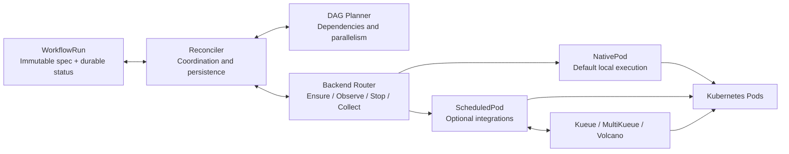

# Milos

English | [Chinese (Simplified)](README.zh-CN.md)

**A Kubernetes-native machine learning workflow engine for heterogeneous CPU and GPU clusters.**

Milos aims to improve scheduling and resource allocation for training and inference workflows: match stages to suitable resources, reduce queueing and idle capacity, and improve workflow completion time and resource efficiency.

The current implementation executes finite Pod DAGs from native `WorkflowRun` resources, with dependency tracking, bounded parallelism, cancellation, deadlines and restart recovery. Native Pods with `default-scheduler` are the default; Kueue, MultiKueue and Volcano integrations are optional and experimental. ML allocation policies, distributed training workloads and online inference support remain future work.

> Prototype: unit and isolated API tests pass. Small CPU DAGs and cancellation have been validated with Kueue and Volcano in a shared cluster. GPU, MultiKueue and production-scale acceptance remain pending.

## Core architecture



- **Workflow core:** the planner computes ready nodes without knowing queue or scheduler types. The reconciler persists execution intent before creation and terminal results before starting successors.
- **Execution layer:** backends share Pod identity and lifecycle helpers. Kueue owns admission, MultiKueue owns remote dispatch, and Volcano owns node scheduling. Milos observes worker resources directly before accepting remote results or confirming cleanup.
- **Persistent state:** `WorkflowRun.spec` stores immutable inputs; `status` stores node results and resource identities. Kubernetes APIs hold active state; no external database is required.

Supported combinations are native/default, native/Volcano, Kueue/default, Kueue/Volcano and MultiKueue/default. Each node currently represents one Pod; MultiKueue/Volcano and multi-Pod gangs are unsupported. Automatic retries and result collection are not enabled, and cross-cluster exactly-once execution is not guaranteed.

## Code structure

```text
milos/
├── api/v1alpha1/             # WorkflowRun API and generated types
├── cmd/controller/          # Manager, integration flags and worker clients
├── internal/
│   ├── workflow/            # Pure DAG validation and planner
│   ├── controller/          # Reconciliation and durable state transitions
│   ├── execution/           # Lifecycle contract and configuration validation
│   ├── backends/
│   │   ├── router.go        # Select the execution path
│   │   ├── nativepod/       # Default local Pod backend
│   │   └── scheduledpod/    # Kueue, MultiKueue and Volcano adapters
│   └── pod/                 # Shared lifecycle, identity and ownership checks
├── config/                  # Generated CRD/RBAC and WorkflowRun samples
├── deploy/                  # Dockerfile, Kustomize overlays and deployment guide
├── tests/                   # Isolated API tests and opt-in live tests
└── docs/                    # Design, integration and development details
```

The implementation uses Go 1.26+, controller-runtime and client-go. External scheduling resources use unstructured clients, without importing upstream controller implementations. Start with the [native WorkflowRun example](config/samples/diamond.yaml); Argo YAML import is not implemented yet.

## Roadmap

- **Validate scheduling integrations:** real Kueue/Volcano execution, MultiKueue dispatch and cancellation, restart recovery and worker outages.
- **Complete the workflow lifecycle:** bounded application retries, result retention and automatic collection; add a focused Argo Workflow YAML importer.
- **Expand workload types:** explore RayJob and TrainJob backends, typed workload configuration and execution groups for distributed training.
- **Optimize ML resource allocation:** establish training and batch-inference benchmarks, then evaluate heterogeneous resource matching, workflow concurrency and GPU utilization. Design online inference separately.

## Documentation

[Development](docs/development.md) · [Architecture](docs/design.md) · [Execution abstraction](docs/execution-abstraction.md) · [Scheduling integrations](docs/scheduling-integrations.md) · [Deployment](deploy/README.md)
