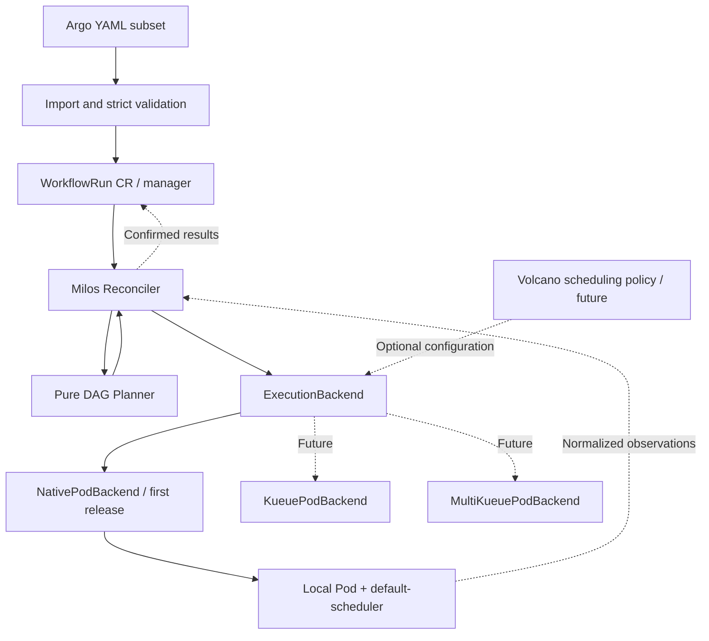

# Milos

English | [Chinese (Simplified)](README.zh-CN.md)

**A Kubernetes-native machine learning workflow engine for heterogeneous CPU and GPU clusters.**

Milos aims to improve scheduling and resource allocation for machine learning training and inference on heterogeneous Kubernetes clusters, matching each workflow stage to the CPU, GPU, and other resources it needs.

The project starts with a reliable Pod workflow execution core. It accepts a focused subset of Argo Workflow YAML and advances DAGs through level-triggered reconciliation. The first release targets native Pods and `default-scheduler` in a single cluster. Future execution backends will integrate Kueue, MultiKueue, and Volcano, providing a foundation for resource and scheduling policies tailored to machine learning workloads.

The name comes from the Mediterranean island of Milos.

> Design stage: this repository contains design documents and input examples. It does not yet provide a controller, CLI, installable CRD package, or runnable release. The behavior described below is planned; cluster integrations have not been validated.

## Project description

Milos is a Kubernetes-native workflow engine being developed to improve scheduling and resource allocation for machine learning training and inference across heterogeneous CPU and GPU clusters. Its initial design uses level-triggered reconciliation to execute a focused subset of Argo Workflow YAML with native Pods and the default scheduler, with an extensible execution layer for future integration with Kueue, MultiKueue, and Volcano.

## Repository

Source: [github.com/wsq2333/milos](https://github.com/wsq2333/milos).

```sh
git clone https://github.com/wsq2333/milos.git
cd milos
```

Start with the [architecture design](docs/design.md) and [execution abstraction](docs/execution-abstraction.md). The planned Go module path is `github.com/wsq2333/milos`; no Go module or runnable implementation has been added yet.

## Goals

The long-term direction follows the practical needs of training and inference:

- **Match workloads to heterogeneous resources.** Distinguish CPU data processing, GPU training, and inference stages, and explore allocation based on device type, device memory, resource requirements, and data location.
- **Improve scheduling at the workflow level.** Account for dependencies, parallelism, and resource availability to reduce queueing, idle capacity, and GPU fragmentation while improving workflow completion times.
- **Allocate resources across shared clusters.** Use optional admission and scheduling integrations to support queues, fair sharing, priorities, and execution across clusters.
- **Measure improvements.** Compare against the default scheduling path using queueing time, end-to-end completion time, CPU/GPU utilization, inference throughput, and resource cost. Choose policies based on workload measurements.

These are research and development goals. The first release does not implement a custom node scheduling algorithm, automatic GPU selection, or multi-Pod distributed training. Training and batch inference can initially be modeled as finite Pod DAGs. Long-running online inference, autoscaling, and latency objectives require a separate future design.

The first release establishes reliable execution: read persistent state, compute the next step, perform idempotent actions, and converge. Each workflow node maps to a Pod, and successors run only after all predecessors succeed.

Milos implements workflow progression itself. It does not run the Argo Controller or Argo executor. Argo YAML is an input format; a dedicated `WorkflowRun` CRD stores active execution state. The first release does not depend on PostgreSQL, a message broker, or callbacks from application containers.

The core acceptance criterion is recovery from controller restarts at any step using only persistent objects. Repeated reconciliation must not create a second task for the same execution identity or overlook an eligible successor. Applications remain responsible for idempotent side effects under cross-cluster failures.

## First-release scope

| Capability | Planned scope |
| --- | --- |
| Input | `Workflow` with one entrypoint DAG and all templates defined in the same document |
| Dependencies | `dag.tasks` and `dependencies`; all predecessors must succeed |
| Execution | `container` templates; one Pod with one application container per node attempt |
| Parameters | Workflow/input string parameters, bound at submission |
| Pod configuration | Explicit allowlist for images, commands, environment variables, resources, volumes, and related fields |
| Failure handling | Skip descendants of failed nodes; continue independent branches; require explicit `dag.failFast: false` |
| Lifecycle | Persistent cancellation intent, workflow timeouts, and bounded application-failure retries |
| Scheduling | Native Pods with default-scheduler in one cluster; no Kueue or Volcano installation required |
| State | Pod status supplies execution facts; WorkflowRun status stores confirmed results |

The first release excludes `steps`, nested DAGs, loops, `when`, enhanced `depends`, output parameters, artifacts, script templates, sidecars, hooks, synchronization locks, WorkflowTemplate references, and multi-Pod gangs. Ordinary parallel nodes are handled independently; the entire DAG is not a gang.

Unsupported execution fields must produce errors rather than being silently discarded. See the [Argo input contract](docs/argo-subset.md) for the field allowlist, parameter scopes, and compatibility boundaries.

## Architecture



| Component | Responsibility |
| --- | --- |
| Milos | DAG progression, execution identity, application retries, node results, cancellation, and cleanup coordination |
| Kubernetes | API persistence, Pod lifecycle, and container execution facts |
| Kueue (future) | Queues, quota, resource admission, and quota-level preemption |
| MultiKueue (future) | Worker selection, remote task management, and status synchronization |
| Volcano (future) | Node scheduling in the execution cluster; device capabilities depend on plugins and deployment configuration |

Initially, NativePodBackend creates, observes, and cleans up local Pods. The DAG planner consumes normalized execution results without depending on queue or scheduler types. ExecutionBackend covers Ensure, Observe, Stop, and Collect; see the [execution abstraction](docs/execution-abstraction.md).

In the future multi-cluster mode, WorkflowRun stays on the manager. Milos creates a manager Pod and delegates remote Pod management to MultiKueue, rather than implementing a competing remote submitter. Single-cluster mode observes the actual execution Pod directly.

MultiKueue documents scheduling gates on manager plain Pods and remote status synchronization. This supports the proposed design, but does not establish that Milos cancellation, recovery, or cleanup has been validated. [Upstream documentation](https://kueue.sigs.k8s.io/v0.20/docs/tasks/run/multikueue/plain_pods/)

## State progression

```text
Read WorkflowRun and observe resources through the backend (Pods only initially)
→ Validate ownership, current attempt, and resource UID
→ Normalize current observations
→ Persist node results and the next execution intent
→ Idempotently create or clean up resources
→ Read again and converge
```

Watch events enqueue reconciliation; they do not directly start successors. Startup recovery, resource watches, and periodic checks of active workflows drive progress. The in-memory queue is not an execution ledger.

Pod success must be persisted before successors can start or Milos-managed garbage collection can remove the Pod. Disconnection, Unknown status, and missing resources require investigation rather than immediate re-execution. Acceptance of a cancellation request and confirmation that remote execution has stopped are recorded separately.

## Input example

[diamond.yaml](examples/diamond.yaml) defines the following dependencies and invokes the same template from multiple tasks:

```text
    prepare
    /     \
  left   right
    \     /
     finish
```

This is an input example for the future importer; Milos cannot execute it yet. The planned import path is: validate Argo YAML, compile an immutable definition, then create a WorkflowRun. Applying the file directly with `kubectl apply` targets an Argo Workflow, not a Milos WorkflowRun.

## Planned code structure and stack

The structure below is planned. The repository currently contains documentation, contributor instructions, and examples only.

```text
milos/
├── cmd/controller/          # Controller manager
├── cmd/milosctl/            # Validation, import, queries, and cancellation
├── api/v1alpha1/            # WorkflowRun types
├── internal/
│   ├── argoyaml/            # Strict parsing and compilation
│   ├── workflow/           # Model, DAG validation, and pure planner
│   ├── controller/         # Reads, reconciliation, and conflict handling
│   ├── execution/          # Lifecycle contract, validation, and backend selection
│   ├── backends/nativepod/ # The only initial backend
│   ├── pod/                # Construction, identity, observation, and cleanup
│   └── observability/      # Logs, metrics, and diagnostics
├── config/{crd,rbac}/
├── charts/milos/            # Single-cluster deployment; worker deployment comes later
├── examples/
├── docs/
└── tests/{integration,e2e}/
```

The planned stack is Go, controller-runtime/client-go, CRD status subresources, controller-gen, Helm, structured logging, and Prometheus. Validation will combine planner unit tests, envtest API integration tests, and real multi-cluster E2E tests. Exact version combinations will be pinned during prototyping; arbitrary version compatibility is not promised.

## Roadmap

1. **Single-cluster core:** NativePodBackend with default-scheduler, strict import, a diamond DAG, failure propagation, and restart recovery.
2. **Lifecycle:** application retries, timeouts, cancellation, result retention, and cleanup.
3. **Local integrations:** Kueue with default-scheduler first, followed by separately validated single-cluster Volcano combinations.
4. **Multiple clusters:** MultiKueue with default-scheduler first, then Volcano combinations; cover disconnection, delayed results, and remote cancellation.
5. **Scale and extensions:** use measurements to decide whether to split out node CRs, introduce execution groups, or expand the YAML subset.
6. **ML workload optimization:** establish training and batch-inference benchmarks; explore heterogeneous resource matching, workflow concurrency policies, GPU utilization, and resource cost. Design online inference support separately as needed.

Each stage has independent acceptance criteria. Third-party integrations do not block the first release. Future multi-cluster support requires proven terminal-result retention and remote cleanup, not just evidence that a remote Pod can run.

## Design documents

- [Architecture and execution protocol](docs/design.md): state authority, reconciliation order, retries, cancellation, module boundaries, acceptance cases, and open questions.
- [Execution abstraction](docs/execution-abstraction.md): the native Pod baseline, lifecycle interfaces, optional dependencies, and backend extensions.
- [Argo input contract](docs/argo-subset.md): supported fields, rejection rules, and semantic differences.

## Documentation language

All new or updated documentation and code comments must use English. [README.zh-CN.md](README.zh-CN.md) is the explicitly maintained Chinese translation; keep it aligned with the English README. Repository instructions are recorded in [AGENTS.md](AGENTS.md).
