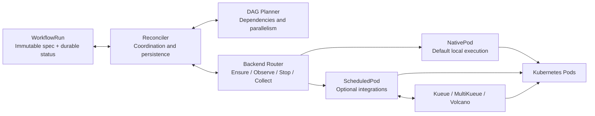

# Milos

English | [Chinese (Simplified)](README.zh-CN.md)

**A Kubernetes-native machine learning workflow engine for heterogeneous CPU and GPU clusters.**

Milos aims to improve scheduling and resource allocation for training and inference workflows: match stages to suitable resources, reduce queueing and idle capacity, and improve workflow completion time and resource efficiency.

The current implementation executes finite Pod DAGs from native `WorkflowRun` resources, with dependency tracking, bounded parallelism, cancellation, workflow/node deadlines, node runtime limits, waiting diagnostics and restart recovery. Native Pods with `default-scheduler` are the default; Kueue, MultiKueue and Volcano integrations are optional and experimental. ML allocation policies, distributed training workloads and online inference support remain future work.

> Prototype: unit and isolated API tests pass. Small CPU DAGs and cancellation have been validated with Kueue and Volcano in a shared cluster. GPU, MultiKueue and production-scale acceptance remain pending.

## Core architecture



- **Workflow core:** the planner computes ready nodes without knowing queue or scheduler types. The reconciler persists execution intent before creation and terminal results before starting successors.
- **Execution layer:** backends share Pod identity and lifecycle helpers. Kueue owns admission, MultiKueue owns remote dispatch, and Volcano owns node scheduling. Milos observes worker resources directly before accepting remote results or confirming cleanup.
- **Persistent state:** `WorkflowRun.spec` stores immutable inputs; `status` stores node results and resource identities. Kubernetes APIs hold active state; no external database is required.

Supported combinations are native/default, native/Volcano, Kueue/default, Kueue/Volcano and MultiKueue/default. Each node currently represents one Pod; MultiKueue/Volcano and multi-Pod gangs are unsupported. Automatic retries and result collection are not enabled, and cross-cluster exactly-once execution is not guaranteed.

## Code structure

```text
milos/
├── api/v1alpha1/             # WorkflowRun API and generated types
├── cmd/controller/          # Manager, integration flags and worker clients
├── internal/
│   ├── workflow/            # Pure DAG validation and planner
│   ├── controller/          # Reconciliation and durable state transitions
│   ├── execution/           # Lifecycle contract and configuration validation
│   ├── backends/
│   │   ├── router.go        # Select the execution path
│   │   ├── nativepod/       # Default local Pod backend
│   │   └── scheduledpod/    # Kueue, MultiKueue and Volcano adapters
│   └── pod/                 # Shared lifecycle, identity and ownership checks
├── config/                  # Generated CRD/RBAC and WorkflowRun samples
├── deploy/                  # Dockerfile, Kustomize overlays and deployment guide
├── tests/                   # Isolated API tests and opt-in live tests
└── docs/                    # Design, integration and development details
```

The implementation uses Go 1.26+, controller-runtime and client-go. External scheduling resources use unstructured clients, without importing upstream controller implementations. Start with the [native WorkflowRun example](config/samples/diamond.yaml); Standard Argo YAML import is not implemented yet; the strict Milos-owned authoring compiler is available.

## Resource-aware authoring

The first native-Pod profile path is implemented. Write a Milos-owned Argo-style Workflow with optional task `milos.requirements.profileRef`, compile it locally, and explicitly create the resulting WorkflowRun:

```sh
make build
bin/milos --file examples/milos/profile-workflow.yaml --namespace YOUR_NAMESPACE > /tmp/workflowrun.yaml
# After an administrator installs the CRDs/controller and a verified profile:
kubectl --context YOUR_CONTEXT create --validate=strict -f /tmp/workflowrun.yaml
```

See the [authoring example](examples/milos/profile-workflow.yaml), [ResourceProfile example](examples/milos/resourceprofile.yaml), and [usage and supported contract](docs/profile-authoring.md). Platform profiles enforce exact node selectors, scheduling tolerations and resource bounds. The controller persists resolution and execution decisions before Pod creation; restarts and profile deletion do not change an accepted execution. Omitted requirements preserve the legacy path.

This first slice supports local native Pods/default-scheduler only. Standard Argo import, parameters, task type/priority/duration extensions, distributed execution, and profile-aware Kueue/Volcano integration remain unsupported and are rejected. The broader [extension design](docs/milos-extensions.md) remains the roadmap. Unit and isolated API coverage do not establish real GPU placement or performance.

## Roadmap

- [x] **Implement the workflow core:** native Pod DAGs, durable execution identities, dependency and parallelism control, cancellation, workflow-wide deadlines and restart recovery. Covered by unit and isolated API tests; live deadline and controller-failover acceptance remain pending.
- [x] **Implement experimental scheduling adapters:** Kueue, Volcano and MultiKueue/default, including identity checks and cancellation cleanup. MultiKueue has isolated API coverage, but no real multi-cluster acceptance yet.
- [x] **Validate local execution in a real cluster:** small CPU diamond DAGs passed for native/default, native/Volcano, Kueue/default and Kueue/Volcano; dependency order, bounded concurrency, admission and PodGroup identity were checked. Running cancellation and cleanup passed for Kueue/Volcano. An independent Argo baseline also passed; this does not validate an Argo importer.
- [ ] **Broaden live acceptance:** workflow deadlines, controller restart/failover, MultiKueue dispatch/cancellation and worker outages, GPU workloads and production-scale behavior.
- [x] **Add node timeout controls:** total and main-container runtime budgets, per-node overrides and visible waiting reasons. Covered by unit and isolated API tests; live acceptance remains pending.
- [ ] **Complete the workflow lifecycle:** separate queue/scheduling/startup limits, bounded application retries, result retention and automatic collection; add a focused Argo Workflow YAML importer.
- [ ] **Expand workload types:** explore RayJob and TrainJob backends, typed workload configuration and execution groups for distributed training.
- [ ] **Optimize ML resource allocation:** establish training and batch-inference benchmarks, then evaluate heterogeneous resource matching, workflow concurrency and GPU utilization. Design online inference separately.

## Documentation

[Development](docs/development.md) · [Architecture](docs/design.md) · [Execution abstraction](docs/execution-abstraction.md) · [Scheduling integrations](docs/scheduling-integrations.md) · [Timeouts](docs/timeouts.md) · [Deployment](deploy/README.md)
