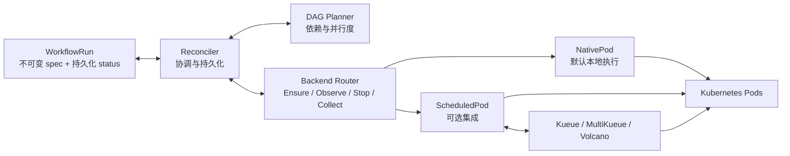

# Milos

[English](README.md) | 简体中文

**面向异构 CPU/GPU 集群的 Kubernetes 原生机器学习工作流引擎。**

Milos 的目标是提升训练与推理工作流的调度和资源分配效率：让各阶段匹配合适的计算资源，减少排队与资源空闲，改善工作流完成时间和资源利用效率。

当前实现通过原生 `WorkflowRun` 资源执行有限时长的 Pod DAG，支持依赖管理、并行度限制、取消、工作流及节点总超时、节点运行超时、等待原因展示和重启恢复。默认使用原生 Pod 与 `default-scheduler`；Kueue、MultiKueue 和 Volcano 是可选的实验性集成。机器学习资源分配策略、分布式训练负载与在线推理支持仍属于后续方向。

> 原型阶段：单元测试与隔离 API 测试已通过；已在共享集群验证 Kueue、Volcano 下的小规模 CPU DAG 和取消清理。GPU、MultiKueue 与生产规模验收仍待完成。

## 核心架构



- **工作流核心**：planner 计算就绪节点，不感知队列或调度器类型；reconciler 在创建资源前持久化执行意图，在启动后继前持久化前驱终态。
- **执行层**：各后端复用 Pod 身份校验与生命周期逻辑。Kueue 负责准入，MultiKueue 负责远端分发，Volcano 负责节点调度。Milos 直接观察 worker 资源，再接受远端结果或确认清理完成。
- **持久化状态**：`WorkflowRun.spec` 保存不可变输入，`status` 保存节点结果和资源身份。活跃状态存放在 Kubernetes API 中，无需外部数据库。

当前支持 native/default、native/Volcano、Kueue/default、Kueue/Volcano、MultiKueue/default。每个节点对应一个 Pod；尚不支持 MultiKueue/Volcano 和多 Pod gang。自动重试与结果自动回收尚未启用，也不保证跨集群 exactly-once 执行。

## 代码结构

```text
milos/
├── api/v1alpha1/             # WorkflowRun API and generated types
├── cmd/controller/          # Manager, integration flags and worker clients
├── internal/
│   ├── workflow/            # Pure DAG validation and planner
│   ├── controller/          # Reconciliation and durable state transitions
│   ├── execution/           # Lifecycle contract and configuration validation
│   ├── backends/
│   │   ├── router.go        # Select the execution path
│   │   ├── nativepod/       # Default local Pod backend
│   │   └── scheduledpod/    # Kueue, MultiKueue and Volcano adapters
│   └── pod/                 # Shared lifecycle, identity and ownership checks
├── config/                  # Generated CRD/RBAC and WorkflowRun samples
├── deploy/                  # Dockerfile, Kustomize overlays and deployment guide
├── tests/                   # Isolated API tests and opt-in live tests
└── docs/                    # Design, integration and development details
```

项目使用 Go 1.26+、controller-runtime 和 client-go。外部调度资源通过 unstructured client 访问，不引入上游控制器实现。可从 [原生 WorkflowRun 示例](config/samples/diamond.yaml) 开始了解输入格式；标准 Argo YAML 导入尚未实现；严格的 Milos 自有编写格式编译器已可用。

## 资源感知编写格式

首个原生 Pod profile 执行路径已实现。使用 Milos 自有 Argo 风格 Workflow，通过可选的任务 `milos.requirements.profileRef` 引用配置，本地编译后显式创建生成的 WorkflowRun：

```sh
make build
bin/milos --file examples/milos/profile-workflow.yaml --namespace YOUR_NAMESPACE > /tmp/workflowrun.yaml
# After an administrator installs the CRDs/controller and a verified profile:
kubectl --context YOUR_CONTEXT create --validate=strict -f /tmp/workflowrun.yaml
```

参见 [编写示例](examples/milos/profile-workflow.yaml)、[ResourceProfile 示例](examples/milos/resourceprofile.yaml) 和 [使用方式与支持边界](docs/profile-authoring.md)。平台 profile 提供精确节点标签约束、调度容忍及资源数量边界。控制器在创建 Pod 前持久化解析结果和执行决策；重启或 profile 删除不会改变已接受的执行。省略需求时保留原有路径。

首版仅支持本地 native Pod/default-scheduler。标准 Argo 导入、参数、任务分类/优先级/耗时扩展、分布式执行及 profile 感知的 Kueue/Volcano 集成仍不支持，并会被拒绝。[完整扩展设计](docs/milos-extensions.md) 保留为路线图。单元与隔离 API 测试不代表真实 GPU 放置或性能已验证。

## Roadmap

- [x] **实现工作流核心**：原生 Pod DAG、持久化执行身份、依赖与并行度控制、取消、工作流整体超时和重启恢复；已有单元测试与隔离 API 测试覆盖，超时及控制器故障恢复的真实集群验收仍待完成。
- [x] **实现实验性调度适配**：Kueue、Volcano、MultiKueue/default，以及身份校验和取消清理；MultiKueue 已有隔离 API 测试覆盖，尚未完成真实多集群验收。
- [x] **完成本地执行路径的真实集群验证**：native/default、native/Volcano、Kueue/default、Kueue/Volcano 四种组合的小规模 CPU 菱形 DAG 均通过，核验了依赖顺序、并发上限、准入和 PodGroup 身份；Kueue/Volcano 运行中取消及清理通过。独立 Argo 基线也已通过，但不代表 Argo 导入器已验证。
- [ ] **扩大真实集群验收**：工作流超时、控制器重启与故障切换、MultiKueue 分发与取消及 worker 失联、GPU 负载和生产规模行为。
- [x] **增加节点超时控制**：节点总耗时及主容器运行预算、节点级覆盖和等待原因展示；已有单元测试与隔离 API 测试覆盖，真实集群验收仍待完成。
- [ ] **完善工作流生命周期**：独立的排队/调度/启动超时、有限业务重试、结果留存与自动回收；增加 Argo Workflow YAML 简单子集导入器。
- [ ] **扩展负载类型**：探索 RayJob、TrainJob 后端、带类型的 workload 配置，以及用于分布式训练的执行组。
- [ ] **优化机器学习资源分配**：建立训练与批量推理基准，再评估异构资源匹配、工作流并发策略和 GPU 利用率；在线推理另行设计。

## 详细文档

[开发指南](docs/development.md) · [架构设计](docs/design.md) · [执行抽象](docs/execution-abstraction.md) · [调度集成](docs/scheduling-integrations.md) · [超时策略](docs/timeouts.md) · [部署指南](deploy/README.md)
