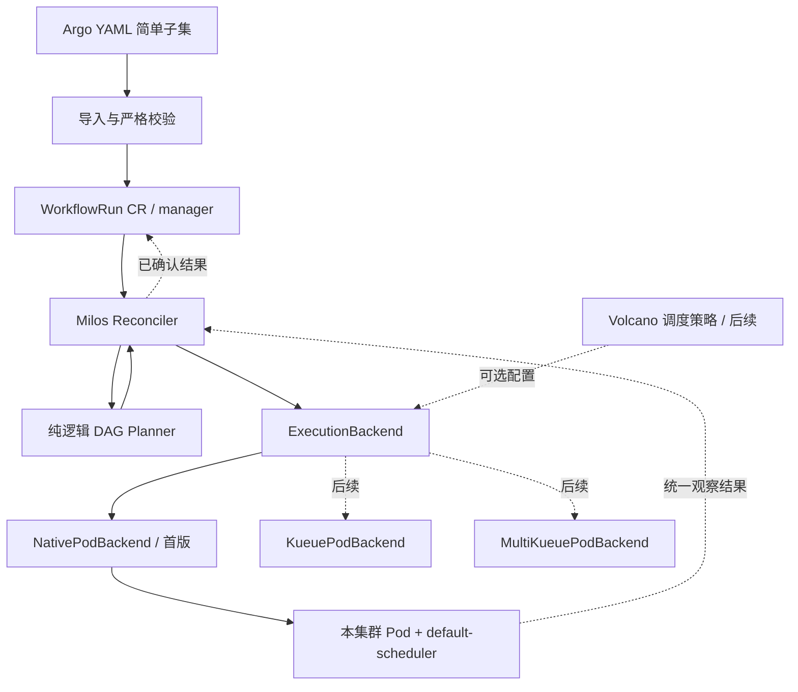

# Milos

[English](README.md) | 简体中文

**面向异构 CPU/GPU 集群的 Kubernetes 原生机器学习工作流引擎。**

Milos 的长期目标是提升机器学习训练与推理工作流在异构 Kubernetes 集群中的调度效率和资源分配效率，让不同阶段的计算需求与 CPU、GPU 及其他资源能力更好地匹配。

项目从可靠的 Pod 工作流执行内核起步：接收 Argo Workflow YAML 的简单子集，以 level-triggered reconciliation 推进 DAG。首版支持单集群原生 Pod 与 `default-scheduler`，后续通过执行后端扩展 Kueue、MultiKueue 和 Volcano，并逐步探索面向机器学习负载的资源与调度策略。

名字取自地中海的米洛斯岛。

> 当前处于设计阶段。仓库包含设计文档与输入示例，尚无 controller、CLI、CRD 安装包或可运行版本。下文描述的是目标行为，集群集成尚未验收。

## English description

Milos is a Kubernetes-native workflow engine being developed to improve scheduling and resource allocation for machine learning training and inference across heterogeneous CPU and GPU clusters. Its initial design uses level-triggered reconciliation to execute a focused subset of Argo Workflow YAML with native Pods and the default scheduler, with an extensible execution layer for future integration with Kueue, MultiKueue, and Volcano.

## 仓库

项目地址：[github.com/wsq2333/milos](https://github.com/wsq2333/milos)。

```sh
git clone https://github.com/wsq2333/milos.git
cd milos
```

可先阅读 [架构设计](docs/design.md) 和 [执行抽象](docs/execution-abstraction.md)。计划中的 Go module 路径为 `github.com/wsq2333/milos`；当前尚未添加 Go module 或可运行实现。

## 项目目标

长期围绕训练与推理的实际需求演进：

- **异构资源匹配**：区分 CPU 数据处理、GPU 训练和推理阶段，探索按设备类型、显存、资源需求及数据位置进行分配。
- **工作流层面的调度效率**：结合依赖关系、并行度和资源可用性，减少排队、资源空闲与 GPU 碎片，提高工作流完成效率。
- **共享集群中的资源分配**：通过可选的准入和调度集成，逐步支持队列、公平共享、优先级及跨集群执行。
- **可衡量的优化**：以默认调度路径为基线，评估排队时间、端到端完成时间、CPU/GPU 利用率、推理吞吐与资源成本；具体策略以负载实测为依据。

这些是长期探索方向，首版不实现自定义节点调度算法、GPU 自动选型或多 Pod 分布式训练。训练和批量推理可以先按有限时长的 Pod DAG 建模；在线推理服务的持续运行、扩缩容与延迟目标需要后续单独设计，不属于首版能力。

首版先建立可靠执行基础：读取持久化状态，计算下一步，幂等执行，再持续收敛。Workflow 的每个节点对应一个 Pod，只有全部前驱成功，才允许启动后继。

项目自行实现工作流推进，不运行 Argo Controller 或 Argo executor。Argo YAML 是输入格式；活跃执行状态由自有 `WorkflowRun` CRD 保存，第一版不依赖 PostgreSQL、消息队列或业务容器回调。

核心验收标准：controller 在任意步骤重启后，仅凭持久化对象恢复进度；不会因为重复 reconcile 创建同一执行身份的第二个任务，也不会漏掉已满足依赖的后继。跨集群故障下的业务副作用仍由应用保证幂等。

## 第一版范围

| 能力 | 设计范围 |
| --- | --- |
| 输入 | `Workflow`，一个入口 DAG，模板全部内联定义 |
| 依赖 | `dag.tasks`、`dependencies`；所有前驱成功后执行 |
| 执行 | `container` 模板；每节点每次尝试一个 Pod、一个业务容器 |
| 参数 | workflow/input 字符串参数；提交时完成绑定 |
| Pod 配置 | 镜像、命令、环境变量、资源、卷等明确白名单 |
| 失败 | 失败后继跳过，独立分支继续；要求显式 `dag.failFast: false` |
| 生命周期 | 持久化取消意图、工作流超时、有限的业务失败重试 |
| 调度 | 单集群原生 Pod + default-scheduler，无 Kueue/Volcano 安装依赖 |
| 状态 | Pod status 提供事实，WorkflowRun status 保存已确认结果 |

第一版不支持 `steps`、嵌套 DAG、循环、`when`、增强 `depends`、输出参数、artifacts、script、sidecar、hooks、同步锁、WorkflowTemplate 引用和多 Pod gang。普通并行节点分别准入，整个 DAG 不作为 gang。

未支持的执行字段必须报错，不能静默丢弃。字段白名单、参数作用域和兼容差异见 [Argo 输入契约](docs/argo-subset.md)。

## 整体架构



| 组件 | 唯一负责的事情 |
| --- | --- |
| Milos | DAG、执行身份、业务重试、节点结果、取消与清理协调 |
| Kubernetes | API 持久化、Pod 生命周期与容器运行事实 |
| Kueue（后续） | 队列、配额、资源准入与配额层抢占 |
| MultiKueue（后续） | worker 选择、远端任务管理与状态同步 |
| Volcano（后续） | 执行集群内的节点调度；设备能力取决于插件和部署配置 |

首版由 NativePodBackend 直接创建、观察和清理本集群 Pod。DAG planner 消费统一执行结果，不感知队列或 scheduler 类型。ExecutionBackend 覆盖 Ensure、Observe、Stop、Collect，具体设计见 [执行抽象](docs/execution-abstraction.md)。

未来跨集群模式下 WorkflowRun 留在 manager。Milos 创建 manager Pod，由 MultiKueue 管理远端 Pod；Milos 不再并行实现一个远端提交器。单集群模式直接观察实际执行 Pod。

MultiKueue 官方文档说明 plain Pod 支持 manager 调度门和远端状态同步；这为设计提供依据，但不代表 Milos 的取消、恢复和清理链路已经通过验证。[上游说明](https://kueue.sigs.k8s.io/v0.20/docs/tasks/run/multikueue/plain_pods/)

## 状态推进

```text
读取 WorkflowRun，经执行后端观察资源（首版仅 Pod）
→ 校验归属、当前 attempt 与资源 UID
→ 归一化当前观察结果
→ 持久化节点结果及下一次执行意图
→ 幂等创建或清理资源
→ 重新读取并收敛
```

watch 事件只唤醒 reconcile，不直接启动后继。启动恢复、资源 watch 和活跃工作流的定时复查共同保证推进；内存队列不是执行账本。

Pod 成功结果必须先保存，后继才能启动，Milos 管理的 GC 才能清理对应 Pod。失联、Unknown、资源缺失都属于需要核查的情况，不直接触发补跑。取消请求已受理和远端执行已停止分别记录。

## 输入示例

[diamond.yaml](examples/diamond.yaml) 定义以下依赖，并演示同一模板的多次调用：

```text
    prepare
    /     \
  left   right
    \     /
     finish
```

这是未来导入器的输入样例，当前不能用 Milos 执行。计划中的导入路径是「校验 Argo YAML → 编译不可变定义 → 创建 WorkflowRun」；直接 `kubectl apply` 该文件会创建 Argo 的 Workflow，而不是 Milos WorkflowRun。

## 代码结构与技术栈

以下是计划结构；目前仓库包含文档、项目协作约定和示例：

```text
milos/
├── cmd/controller/          # controller manager
├── cmd/milosctl/            # 校验、导入、查询、取消
├── api/v1alpha1/            # WorkflowRun 类型
├── internal/
│   ├── argoyaml/            # 严格解析与编译
│   ├── workflow/           # 模型、DAG 校验、纯逻辑 planner
│   ├── controller/         # 读取、reconcile、冲突处理
│   ├── execution/          # 生命周期契约、配置校验、后端选择
│   ├── backends/nativepod/ # 首版唯一后端
│   ├── pod/                # Pod 构建、身份、观察、清理
│   └── observability/      # 日志、指标、诊断
├── config/{crd,rbac}/
├── charts/milos/            # 首版单集群部署；worker 部署后续增加
├── examples/
├── docs/
└── tests/{integration,e2e}/
```

采用 Go、controller-runtime/client-go、CRD status subresource、controller-gen、Helm、结构化日志和 Prometheus。测试分为 planner 单元测试、envtest API 集成测试与真实多集群 E2E。具体版本组合将在原型阶段锁定，不承诺任意版本兼容。

## 实施顺序

1. **单集群内核**：NativePodBackend + default-scheduler，严格导入、菱形 DAG、失败传播和重启恢复。
2. **生命周期**：业务重试、超时、取消、结果留存和清理。
3. **本地扩展**：先 Kueue + default-scheduler，再分别验证单集群 Volcano 组合。
4. **跨集群**：先 MultiKueue + default-scheduler，再验证 Volcano 组合；覆盖失联、迟到结果与远端取消。
5. **规模与扩展**：根据实测决定是否拆分节点 CR、增加执行组及更多 YAML 能力。
6. **机器学习负载优化**：建立训练与批量推理基准，逐步探索异构资源匹配、工作流并发策略、GPU 利用率与资源成本优化；按需求另行设计在线推理支持。

每个阶段独立验收，首版不被第三方集成阻塞。后续跨集群能力的发布前置条件是证明终态留存和远端清理闭环；远端 Pod 能运行只是其中一个用例。

## 设计资料

- [架构与执行协议](docs/design.md)：状态权威、reconcile 顺序、重试和取消、模块边界、验收用例及开放问题。
- [执行抽象](docs/execution-abstraction.md)：原生 Pod 首版、完整生命周期接口、可选依赖与后续后端扩展。
- [Argo 输入契约](docs/argo-subset.md)：白名单、拒绝规则与语义差异。

## 文档语言

后续新增或修改的文档与代码注释统一使用英文。本文件是明确保留的中文译本，应与 [英文 README](README.md) 保持内容同步。项目约定记录在 [AGENTS.md](AGENTS.md) 中。
