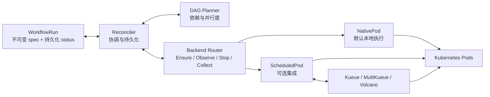
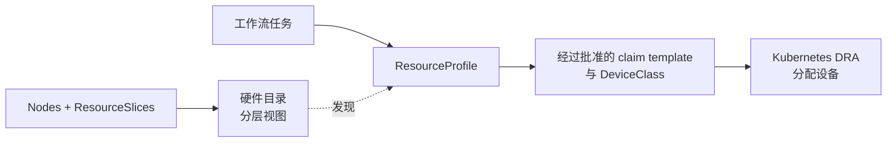

# Milos

[English](README.md) | 简体中文

**面向异构 CPU/GPU 集群的 Kubernetes 原生机器学习工作流引擎。**

Milos 的目标是提升训练与推理工作流的调度和资源分配效率：让各阶段匹配合适的计算资源，减少排队与资源空闲，改善工作流完成时间和资源利用效率。

当前实现通过原生 `WorkflowRun` 资源执行有限时长的 Pod DAG，支持依赖管理、并行度限制、取消、工作流及节点总超时、节点运行超时、等待原因展示和重启恢复。默认使用原生 Pod 与 `default-scheduler`；Kueue、MultiKueue 和 Volcano 是可选的实验性集成。机器学习资源分配策略、分布式训练负载与在线推理支持仍属于后续方向。

> 原型阶段：单元测试与隔离 API 测试已通过；已在共享集群验证 Kueue、Volcano 下的小规模 CPU DAG 和取消清理。GPU、MultiKueue 与生产规模验收仍待完成。

## 核心功能

| 功能 | 状态 | 提供的能力 |
| --- | --- | --- |
| 工作流编排 | 已实现 | 有限时长 Pod DAG、依赖追踪与并行度限制 |
| Argo 风格编写格式 | 已实现子集 | 将严格 Milos YAML 编译为 WorkflowRun；标准 Argo 导入仍在规划中 |
| ResourceProfile 目录与约束 | 已实现，限 native/default | 列出 profile、查看指导与边界，并执行 Pod 选择器、toleration 和资源检查 |
| 重启安全执行 | 已实现 | 在创建资源前持久化执行决策与身份 |
| 执行控制与诊断 | 已实现 | 取消、工作流/节点超时与等待原因展示 |
| 调度适配 | 实验性 | Kueue 准入、Volcano 放置，以及 MultiKueue/default 远端执行 |
| DRA profile 与硬件视图 | 规划中 | 经过批准的设备 claim、驱动负责的硬件清单，以及轻量分层目录 |
| 分布式拓扑与网络 | 规划中 | 执行组、先本地 TAS 再 worker 侧 TAS/DRA，以及网络设备需求；Volcano 作为另一种选择 |
| 基于实测的资源优化 | 规划中 | 先推荐硬件，再根据完成时间、成本和公平性进行受约束的选择 |

规划中的功能是设计目标，不代表当前能力。交付与验收标准见 [路线图](#roadmap) 和 [DRA/TAS 设计](docs/resource-pools.md)。

## 核心架构



- **工作流核心**：planner 计算就绪节点，不感知队列或调度器类型；reconciler 在创建资源前持久化执行意图，在启动后继前持久化前驱终态。
- **执行层**：各后端复用 Pod 身份校验与生命周期逻辑。Kueue 负责准入，MultiKueue 负责远端分发，Volcano 负责节点调度。Milos 直接观察 worker 资源，再接受远端结果或确认清理完成。
- **持久化状态**：`WorkflowRun.spec` 保存不可变输入，`status` 保存节点结果和资源身份。活跃状态存放在 Kubernetes API 中，无需外部数据库。

当前支持 native/default、native/Volcano、Kueue/default、Kueue/Volcano、MultiKueue/default。每个节点对应一个 Pod；尚不支持 MultiKueue/Volcano 和多 Pod gang。自动重试与结果自动回收尚未启用，也不保证跨集群 exactly-once 执行。

## 代码结构

```text
milos/
├── api/v1alpha1/             # WorkflowRun / ResourceProfile APIs and generated types
├── cmd/
│   ├── controller/          # Controller manager, integration flags and worker clients
│   └── milos/               # Authoring compiler CLI and profile catalog commands
├── internal/
│   ├── authoring/           # Strict Milos Workflow-to-WorkflowRun compiler
│   ├── catalog/             # Read-only profile discovery and display
│   ├── resources/           # Profile validation, resolution and snapshot digests
│   ├── workflow/            # Pure DAG validation and planner
│   ├── controller/          # Reconciliation, durable decisions and node timeouts
│   ├── execution/           # Backend lifecycle contract and configuration validation
│   ├── backends/
│   │   ├── router.go        # Select the execution path
│   │   ├── nativepod/       # Default local Pod backend
│   │   └── scheduledpod/    # Kueue, MultiKueue and Volcano adapters
│   └── pod/                 # Shared Pod lifecycle, identity and ownership checks
├── config/
│   ├── crd/                # Generated CRD schemas and Kustomize entrypoint
│   ├── rbac/               # Generated roles, service account and base binding
│   └── samples/            # Native WorkflowRun and timeout examples
├── deploy/
│   ├── Dockerfile          # Controller image build
│   ├── base/               # Namespace and controller deployment
│   ├── crds/               # CRD installation entrypoint
│   ├── overlays/           # Native and optional scheduling deployment modes
│   ├── rbac/               # Optional integration bindings and worker reader role
│   └── sim-prod/           # Dedicated smoke-test deployment rendering and guide
├── examples/
│   ├── diamond.yaml        # Input for the planned standard Argo importer
│   └── milos/              # Implemented authoring, ResourceProfile and catalog RBAC examples
├── example/                # Cluster smoke-test DAGs, Argo baseline and verification script
├── tests/
│   ├── integration/        # Isolated API-server contract and recovery tests
│   └── live/               # Opt-in real-cluster scheduling tests
├── docs/                   # Architecture, authoring, extensions and operational guides
├── Makefile                # Build, generation, lint and test entrypoints
├── go.mod / go.sum         # Go module and dependency checksums
└── AGENTS.md               # Repository contribution instructions
```

项目使用 Go 1.26+、controller-runtime 和 client-go。外部调度资源通过 unstructured client 访问，不引入上游控制器实现。可从 [原生 WorkflowRun 示例](config/samples/diamond.yaml) 或 [Milos 编写示例](examples/milos/profile-workflow.yaml) 开始了解输入格式。标准 Argo YAML 导入尚未实现；严格的 Milos 自有编写格式编译器已可用。

单元测试以 `*_test.go` 放在对应包中；`tests/` 存放 API 与真实集群集成测试。`make build` 生成被 Git 忽略的 `bin/milos` 和 `bin/milos-controller`。目前两个示例目录用途不同：`examples/` 存放编写格式与 profile 输入，[example/](example/README.md) 存放集群冒烟测试负载及验证工具。

## 资源感知编写格式

首个原生 Pod profile 执行路径已实现。使用 Milos 自有 Argo 风格 Workflow，通过可选的任务 `milos.requirements.profileRef` 引用配置，本地编译后显式创建生成的 WorkflowRun：

```sh
make build
bin/milos --file examples/milos/profile-workflow.yaml --namespace YOUR_NAMESPACE > /tmp/workflowrun.yaml
# After an administrator installs the CRDs/controller and a verified profile:
kubectl --context YOUR_CONTEXT create --validate=strict -f /tmp/workflowrun.yaml
```

参见 [编写示例](examples/milos/profile-workflow.yaml)、[ResourceProfile 示例](examples/milos/resourceprofile.yaml) 和 [使用方式与支持边界](docs/profile-authoring.md)。平台 profile 提供精确节点标签约束、调度容忍及资源数量边界。控制器在创建 Pod 前持久化解析结果和执行决策；重启或 profile 删除不会改变已接受的执行。省略需求时保留原有路径。

首版仅支持本地 native Pod/default-scheduler。标准 Argo 导入、参数、任务分类/优先级/耗时扩展、分布式执行及 profile 感知的 Kueue/Volcano 集成仍不支持，并会被拒绝。[完整扩展设计](docs/milos-extensions.md) 保留为路线图。单元与隔离 API 测试不代表真实 GPU 放置或性能已验证。

### ResourceProfile 目录

选择任务的 `profileRef` 前，可列出已发布的 profile 并查看用途：

```sh
bin/milos profiles list --namespace YOUR_NAMESPACE --context YOUR_CONTEXT
bin/milos profiles describe h20-exclusive-v1 --namespace YOUR_NAMESPACE --context YOUR_CONTEXT
```

目录展示描述、实际执行的资源数量边界，以及管理员声明的兼容性要求。兼容性文字属于使用指导，不会自动验证；profile 已发布不代表当前有可用容量。未填写目录信息的旧 profile 仍可使用。命令使用调用者凭据，需要命名空间内的 `get`/`list` 权限。参见 [目录使用与只读 RBAC](docs/profile-authoring.md#discover-available-profiles)。

### 规划中的 DRA profile 与硬件视图

ResourceProfile 保留为面向工作流的接口。拟议设备路径使用 Kubernetes DRA，分层资源池则作为现有硬件清单的只读视图：



DRA 集成仍是规划，尚未实现。现有 device-plugin profile 保持原有行为；独立 ResourcePool/NodeHardware CRD 暂缓引入。参见 [设计与示例](docs/resource-pools.md)。

拓扑路径保留为 **本地 Kueue TAS → MultiKueue worker 侧 TAS/DRA**，Volcano 作为需单独验证的另一种选择。[网络模型](docs/resource-pools.md#network-resources) 分别描述连接关系、设备分配和性能；局部性不保证带宽。

## Roadmap

- [x] **实现工作流核心**：原生 Pod DAG、持久化执行身份、依赖与并行度控制、取消、工作流整体超时和重启恢复；已有单元测试与隔离 API 测试覆盖，超时及控制器故障恢复的真实集群验收仍待完成。
- [x] **实现实验性调度适配**：Kueue、Volcano、MultiKueue/default，以及身份校验和取消清理；MultiKueue 已有隔离 API 测试覆盖，尚未完成真实多集群验收。
- [x] **完成本地执行路径的真实集群验证**：native/default、native/Volcano、Kueue/default、Kueue/Volcano 四种组合的小规模 CPU 菱形 DAG 均通过，核验了依赖顺序、并发上限、准入和 PodGroup 身份；Kueue/Volcano 运行中取消及清理通过。独立 Argo 基线也已通过，但不代表 Argo 导入器已验证。
- [ ] **扩大真实集群验收**：工作流超时、控制器重启与故障切换、MultiKueue 分发与取消及 worker 失联、GPU 负载和生产规模行为。
- [x] **增加节点超时控制**：节点总耗时及主容器运行预算、节点级覆盖和等待原因展示；已有单元测试与隔离 API 测试覆盖，真实集群验收仍待完成。
- [x] **增加原生 ResourceProfile 与目录发现**：严格 Milos 编写格式、持久化 native/default 决策、强制执行的节点选择与资源边界，以及 profile list/describe；硬件观测和真实 GPU 放置仍未验证。
- [ ] **H1 — 复用设备清单**：只读 Node/ResourceSlice 目录、可信补充信息和分层视图，不另建重复的设备数据库。
- [ ] **H2 — 增加 DRA 原生 profile**：经过批准的 claim template、不可变策略约束、claim 身份与清理，以及重启恢复；保留现有 profile 行为。
- [ ] **H3 — 集成 Kueue DRA 与 TAS**：配额映射、设备可行性检查、经过授权的优先级和等待诊断；Volcano 单独验证。
- [ ] **完善工作流生命周期**：独立的排队/调度/启动超时、有限业务重试、结果留存与自动回收；增加 Argo Workflow YAML 简单子集导入器。
- [ ] **H4a — 验证本地 TAS 执行组**：探索 TrainJob/RayJob 执行组、PodSet 分组、局部性和网络设备 claim，并明确恢复责任。
- [ ] **H4b — 增加 MultiKueue worker 侧 TAS/DRA**：经过批准的 worker class/template、整个执行组分发、claim/放置结果观测与失联清理。
- [ ] **H5 — 优化机器学习资源分配**：建立训练、评估、仿真与 3DGS 基准；先推荐硬件，再开放受约束的自动选择，衡量完成时间、成本、碎片与公平性；在线推理另行设计。

依赖关系与业务价值见 [硬件路线图及验收标准](docs/resource-pools.md#delivery-roadmap-and-acceptance)。下一步硬件工作先完成 H1，再打通范围有限的 H2 DRA 路径；生命周期与真实集群验收仍需继续。

## 详细文档

[开发指南](docs/development.md) · [架构设计](docs/design.md) · [DRA profile 与硬件设计](docs/resource-pools.md) · [工作流扩展](docs/milos-extensions.md) · [执行抽象](docs/execution-abstraction.md) · [调度集成](docs/scheduling-integrations.md) · [超时策略](docs/timeouts.md) · [部署指南](deploy/README.md)
