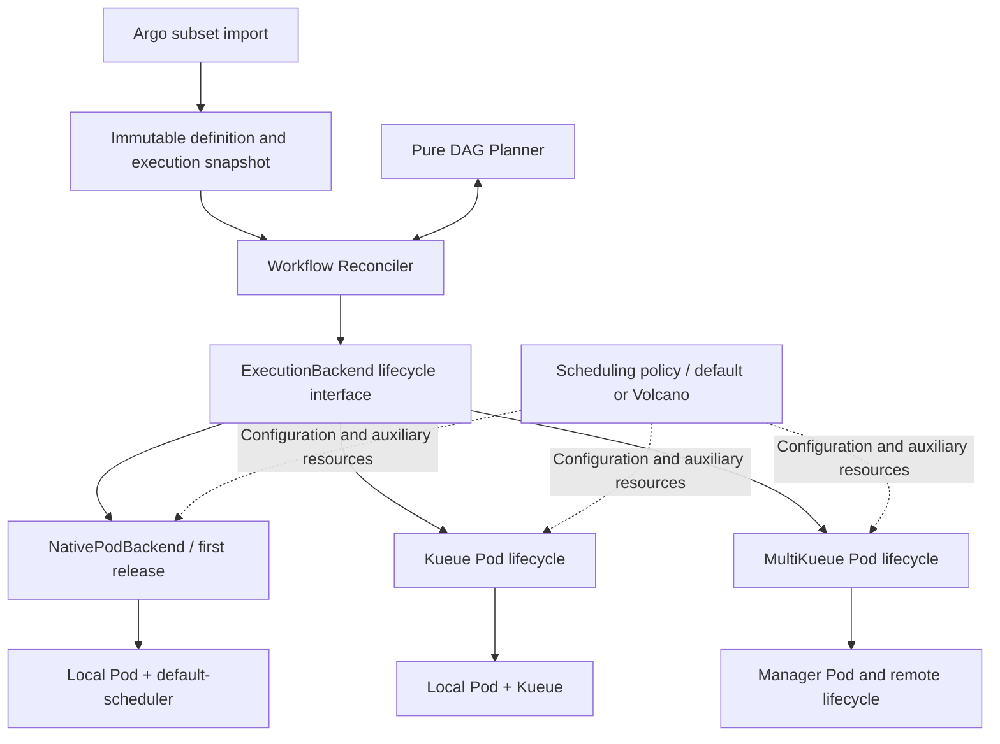

# Execution abstraction: native Pods and optional scheduling integrations

Status: target design with a native Pod core and experimental optional scheduling adapters. See [development status](development.md) and [scheduling integrations](scheduling-integrations.md) for the implemented contract and validation boundaries. Interfaces and examples below also include planned capabilities.

## 1. Abstract one execution

The workflow core needs to know whether a node can start, whether its current execution has finished, and whether it can retry. It should not need to understand Workload, AdmissionCheck, or PodGroup.

Define an internal `ExecutionBackend` between Workflow Reconciler and Kubernetes operations. The interface covers creation, observation, stopping, and resource collection after results are retained, rather than wrapping only `CreatePod()`. The initial execution unit remains a Pod; do not design a universal execution language for VMs, Jobs, or arbitrary resources before they are needed.



`ExecutionBackend` is an in-process Go interface, not a new service, dynamic plugin system, or separate CRD. WorkflowRun.status remains the sole authoritative record of finalized node results.

## 2. Three dimensions with validated combinations

| Dimension | Question | First release | Future |
| --- | --- | --- | --- |
| Admission | When may the task consume resources? | None; no Milos-managed queue admission | Kueue |
| Placement | Which cluster executes the task? | Local; the cluster containing WorkflowRun | MultiKueue |
| Scheduler | Who chooses a node within that cluster? | default-scheduler | Volcano |

Initially, express these dimensions as typed configuration and module responsibilities, not three freely composable plugin interfaces. Kueue and MultiKueue have protocol dependencies and cannot be combined as independent, interchangeable plugins.

A Pod's `spec.schedulerName` selects its scheduler; it does not automatically provide quota admission or cross-cluster dispatch. [Kubernetes multiple-scheduler documentation](https://kubernetes.io/docs/tasks/extend-kubernetes/configure-multiple-schedulers/)

The implemented allowlist is explicit. Optional combinations remain experimental until live acceptance is complete:

| Backend | Admission | Placement | Scheduler | Delivery stage |
| --- | --- | --- | --- | --- |
| native-pod | None | Local | default-scheduler | Default baseline |
| kueue-pod | Kueue | Local | default-scheduler | Experimental adapter |
| native-pod / kueue-pod | None / Kueue | Local | Volcano | Experimental adapters; validate each combination separately |
| multikueue-pod | Kueue | MultiKueue | default-scheduler | Experimental adapter; live acceptance pending |
| multikueue-pod | Kueue | MultiKueue | Volcano | Rejected; future design |

Changing the scheduler does not necessarily require a new backend type. Introduce a backend when the execution lifecycle protocol changes materially. If Volcano requires auxiliary objects, their lifecycle belongs to the execution backend. Multi-Pod gangs change the execution unit and are outside the initial interface contract.

## 3. Configuration and stable identity

Use an immutable `spec.execution` in place of the earlier draft's `spec.scheduling`. The initial configuration after defaulting is conceptually:

```yaml
spec:
  execution:
    backend: native-pod
    contractVersion: v1
    admission:
      provider: None
    placement:
      provider: Local
    scheduler:
      name: default-scheduler
```

Users may omit the entire execution block; the importer/API defaults and persists this snapshot. Validation derives the backend from an allowed configuration combination. Reject directly submitted backend values that conflict with the other fields rather than silently choosing one. Disabled integrations and unsupported combinations fail without falling back to the native path.

Kueue configuration uses `admission.queueRef`, referring to a LocalQueue in the WorkflowRun namespace. MultiKueue configuration selects a platform-configured dispatch policy; users cannot supply arbitrary strings as worker credentials. Validate scheduling configuration for the actual backend rather than passing through arbitrary JSON extension fields.

An ExecutionProfile CRD is unnecessary initially. Named profiles may be added later, but WorkflowRun creation must resolve them into a configuration snapshot with a version/digest. Profile updates cannot change in-flight workflows. Controller upgrades must continue supporting in-flight contractVersion values. If a backend is unavailable, stop creation and report the reason rather than falling back to native-pod.

Retain the execution key `(Workflow UID, node ID, attempt, dispatchGeneration)`. Initially, dispatchGeneration is fixed at 0, with no automatic infrastructure redispatch. Each execution records its backend ID, contractVersion, stable resource names, and actual UIDs. Backend selection and template inputs both contribute to the execution digest.

Use a common resource reference:

```text
ResourceRef = clusterID + apiVersion + kind + namespace + name + UID + role
```

The `role` field distinguishes ControlPod, ExecutionPod, AdmissionWorkload, and SchedulerAuxiliary. In native mode, one Pod serves both control and execution roles without duplicating the resource. Leave unknown worker UIDs unset rather than substituting a manager UID. clusterID represents stable cluster identity; a renameable kubeconfig context alone is insufficient.

## 4. Minimal lifecycle interface

The following interface is a draft; refine type details during prototyping:

```go
type ExecutionBackend interface {
    Ensure(ctx context.Context, req ExecutionRequest, h ExecutionHandle) (BackendUpdate, error)
    Observe(ctx context.Context, req ExecutionRequest, h ExecutionHandle) (Observation, error)
    Stop(ctx context.Context, req ExecutionRequest, h ExecutionHandle) (BackendUpdate, error)
    Collect(ctx context.Context, req ExecutionRequest, h ExecutionHandle, ack ResultAck) (BackendUpdate, error)
}
```

Configuration validation and backend resolution belong in submission/startup resolvers, rather than repeating configuration discovery in every reconciliation. Method semantics are:

| Method | Behavior | Required guarantees |
| --- | --- | --- |
| Ensure | Ensure resources exist for this execution key and discover related resources | Execution intent is already persisted; stable names; ownership validation; no new attempt allocation |
| Observe | Read and normalize facts, diagnostics, resource references, and cleanup evidence | No creation/deletion side effects; uncertainty is not reported as failure |
| Stop | Converge toward stopped execution and report stop/cleanup progress | Repeatable; UID preconditions; accepted deletion is not completion |
| Collect | Reclaim resources after results have been saved | Persistent acknowledgement matches the execution and result; unacknowledged results cannot be lost |

Stop and Collect are separate because cancellation must stop running execution even without a success/failure result. Collection after natural completion must wait for result acknowledgement.

`ExecutionRequest` contains the execution key, immutable configuration, bound single-Pod input, and control intent, not the entire workflow graph. Shared Pod builders may use Kubernetes Pod types, but planner inputs do not expose them.

`ExecutionHandle` is a bounded, serializable snapshot of identity and resource associations in status. It may be empty initially and must not contain clients, cached objects, or in-memory sessions. `BackendUpdate` returns discovered handle data, current progress, and a suggested recheck. If creation succeeds but persistence fails, the backend must rediscover resources by stable execution key; it cannot depend on its previous return value having been saved.

Failed calls may return discovered references and diagnostics. The Reconciler persists partial results supported by evidence without treating temporary errors as terminal outcomes. Even with an empty handle, Stop must inspect the request's stable resource names for Pods that may have been created but not recorded. It cannot immediately report that no cleanup is necessary.

The Reconciler constructs `ResultAck` only after confirming that the current execution result is committed to WorkflowRun.status. It binds the execution key, result digest, and resource UID. This is an internal protocol, not a user-submitted authorization token. Backends do not write WorkflowRun.status themselves.

Every method is a bounded reconciliation step, not a blocking wait for task completion. Return network failures to the work queue for retry. Retrying the same temporarily failed operation is distinct from an application attempt retry.

## 5. Normalized observation model

Do not use `Pending` interchangeably for quota waits, node waits, and remote disconnection. Observation should distinguish at least:

| Field | Meaning and examples |
| --- | --- |
| executionKey / refs | The execution and UIDs to which this observation belongs |
| phase | Currently confirmed Pending, Running, Succeeded, Failed, or Unknown |
| admission | NotRequired, Waiting, Admitted, Unknown |
| placement | Local or Remote; dispatching, associated, or unknown |
| freshness | Available or unconfirmed, with source and reason; Pod update time is not a heartbeat |
| failureClass | Application, Infrastructure, AdmissionEvicted, Unknown |
| stopProgress | NotRequested, Stopping, Confirmed, or Unknown |
| cleanupProgress | Pending, Complete, or Unknown |
| terminalEvidence | Current execution identity, outcome, exit reason, and observation source |
| requeueAfter | Suggested next bounded check |

These are independent dimensions, not a requirement to create a node phase for every combination. Observe must not label stale cache data as current fact. Pod NotFound and API unavailability must be represented separately. The Reconciler still validates and persists reported terminal outcomes before the planner can release successors.

NativePodBackend reports admission=NotRequired. Reading a local Pod successfully yields facts currently visible through that API, but does not prove the node remains healthy. MultiKueue backends must distinguish a successful manager read from reliable worker observation.

The planner consumes only normalized results, waiting/unknown reasons, stop progress, and policy. It does not import Kueue/Volcano types, match their reason strings, or branch on backend names.

### Retry and recovery ownership

The planner always decides whether to retry an application failure. Backends report failure classification and whether execution has reliably stopped; they do not independently increment the application attempt.

The first native Pod implementation does not automatically recreate a Pod that disappears for an unknown reason. Future Kueue preemption needs a separate recovery rule: its documentation states that preemption terminates and deletes plain Pods, which cannot simply be classified as ApplicationFailed. [Kueue plain Pod limitations](https://kueue.sigs.k8s.io/docs/tasks/run/plain_pods/)

A future normalized `RecoveryRequired` proposal and bounded recovery budget may let the coordinator persist a new dispatchGeneration before permitting recreation. If MultiKueue owns redispatch, Milos must not run a competing mechanism. Recovery policy does not need an empty plugin implementation in the first release, and automatic recovery cannot be assumed for all backends.

## 6. Initial NativePodBackend scope

1. Build a single-container Pod with explicit `schedulerName: default-scheduler`, `restartPolicy: Never`, Milos identity, and ownerReference.
2. Do not inject Kueue queue labels, Kueue scheduling gates, or Volcano metadata.
3. Ensure uses stable-name Create/Get and validates identity and input digest on AlreadyExists.
4. Observe uses local Pod status. Scheduled=False/Unschedulable means waiting; a nonzero container exit is a potential application failure.
5. The Reconciler persists stop intent. The backend performs normal UID-guarded deletion and reports progress from the agreed evidence.
6. Collect deletes retained terminal Pods after result acknowledgement and remains repeatable after restarts.

Disappearance from the API does not prove that a process has physically stopped under every network partition. Initial cleanup completion follows normal Kubernetes deletion semantics. Forced deletion, node isolation, or other insufficient evidence cannot justify exactly-once side-effect guarantees or immediate safe re-execution.

Startup installs/discovers only WorkflowRun and native Kubernetes APIs, watches only WorkflowRun/Pod, and requests the corresponding permissions plus leader-election Leases. The system must start and execute without Kueue/Volcano CRDs or worker configuration.

Installing Kueue in a cluster does not mean it should manage native-pod executions. Deployment must establish explicit namespace/admission scope. native-pod must not remove another controller's gates. If the environment unexpectedly injects execution-control fields outside this backend's ownership, report a policy conflict or waiting reason and correct deployment configuration.

## 7. Optional integration responsibilities

### Kueue: local admission lifecycle

The Kueue path in `scheduledpod.Backend` reuses the Pod builder, identity checks, and basic status parsing, then adds queue mapping, Workload associations, admission observation, eviction classification, and cleanup coordination. Kueue owns its gates and Workloads; Milos does not mark them admitted or remove their gates.

A `DecoratePod()` function alone is insufficient. Missing Pods need admission/eviction context and may require a recovery protocol. Reuse shared functions or concrete collaborators rather than requiring one backend to wrap another and override half its methods.

### MultiKueue: remote facts and stop confirmation

The MultiKueue path in `scheduledpod.Backend` creates manager Pods, delegates dispatch upstream, and returns the normalized observation model. Remote status synchronization for plain Pods is documented, but cleanup confirmation and redispatch isolation still require version-specific validation. [MultiKueue documentation](https://kueue.sigs.k8s.io/v0.20/docs/tasks/run/multikueue/plain_pods/)

Do not reuse NativePodBackend's local-deletion completion rule: manager NotFound does not establish that a worker has stopped. Encapsulate remote UIDs, Workload associations, connectivity diagnostics, and any necessary cleanup receipts in this backend while sharing node finalization and DAG dependency logic.

### Volcano: single-Pod scheduling policy first

First validate single-Pod configuration with schedulerName=volcano and any necessary scheduling auxiliary resources. If the selected version/configuration requires an auxiliary PodGroup, the backend must cover it in Ensure/Observe/Stop/Collect. Creating an object without owning its cleanup is insufficient.

Start with concrete scheduler configuration compilation functions, without requiring a SchedulerProvider interface. Extract a narrow interface only after two genuinely different auxiliary-resource lifecycle implementations exist. Multi-Pod gangs need a separate ExecutionGroup, member identity, and group admission design; labeling the entire DAG is not enough.

## 8. Optional dependencies, versions, and watches

Enable backends explicitly through startup configuration, then validate their APIs, permissions, and configuration. The current implementation uses direct reads and periodic reconciliation for optional resources; future dynamic watches and indexes must be registered only for enabled backends. Missing Workload GVKs must not break startup of the default path. Registering Go API types in a scheme is different from actual discovery/list/watch and does not itself establish a runtime dependency.

If an enabled backend lacks a dependency, report its configuration as unavailable and prevent submissions on that path. Preserve in-flight workflow state while waiting for repair; never silently downgrade execution. A failure of that optional API must not disrupt native-pod executions that do not use it. Health reporting and metrics should distinguish controller liveness from individual backend availability.

Watches only map resources to workflows; mapping rules belong to backend startup adapters. Initially, a Pod owner index is sufficient. Future Workload watches must preserve recovery through reads and periodic reconciliation, without depending on a particular one-time event.

## 9. Code organization and dependency direction

```text
internal/
├── workflow/                 # Pure DAG validation and planner
├── controller/               # Lifecycle coordination and durable state
├── execution/                # Contract and configuration validation
├── backends/
│   ├── router.go             # Select the execution path
│   ├── nativepod/            # Default local execution
│   └── scheduledpod/         # Kueue, MultiKueue and Volcano adapters
└── pod/                      # Shared lifecycle, builder and identity checks
```

The dependency direction is `controller → execution contract ← backends`; the planner does not depend on backends. The startup entrypoint injects a router. Backends neither call the planner nor patch WorkflowRun status directly. Optional APIs are accessed structurally without importing upstream controllers.

## 10. Staged validation

| Stage | Required evidence |
| --- | --- |
| V1 native-pod | Complete DAGs without third-party CRDs; use default-scheduler; correct recovery, cancellation, and garbage collection |
| V2 Kueue + default scheduler | Normalize waiting, admission, and preemption without changing the DAG planner |
| V3 Single-cluster Volcano | Default and Volcano paths each pass lifecycle tests; do not require Kueue in every combination |
| V4 MultiKueue + default scheduler | Explicit evidence for remote facts, disconnection, late results, redispatch, and cancellation |
| V5 Combined validation | Test MultiKueue + Volcano together and publish a pinned-version support matrix |

Shared backend contract tests cover repeated Ensure, uncertain creation outcomes, same-name/different-UID conflicts, rebuilding associations after restart with an empty handle, repeated Stop, prohibition of Collect before terminal-result acknowledgement, and Unknown observations not triggering application retries. Backend-specific protocols require their own E2E tests; fake clients and envtest cannot establish real scheduler, kubelet, or cross-cluster behavior.

The interface succeeds when adding a backend changes backend code, configuration resolution, watches, and deployment while preserving dependency evaluation, failure propagation, and workflow aggregation. Future execution semantics such as gangs or output collection should explicitly evolve the contract rather than assuming the current interface covers everything.
