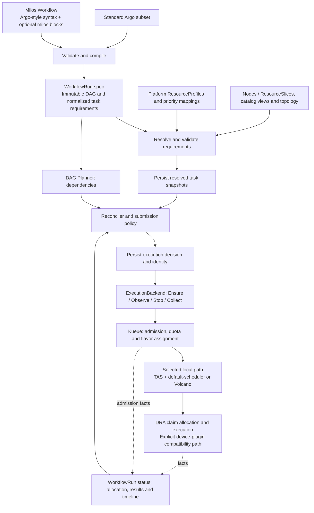

# Planned Milos workflow extensions

Status: long-term design. A narrower native-Pod profile slice is implemented; see [the actual schema, usage and acceptance boundary](profile-authoring.md). Standard Argo import and the additional extensions below remain planned. The schemas below are proposals, not the implemented API; `milos.example.io` remains a placeholder API group.

The [DRA-backed hardware design](resource-pools.md) defines the H1–H5 roadmap: ResourceProfile is the workflow contract, DRA owns device inventory/allocation, and hierarchical pools are read-only catalog views. Standalone ResourcePool/NodeHardware CRDs are deferred; TAS, MultiKueue and network requirements remain planned.

## Authoring and execution boundaries

Use a Milos-owned `Workflow` document with familiar Argo DAG, template and container syntax. Put every custom authoring field under `milos`: task extensions under `dag.tasks[].milos`, workflow extensions under `spec.milos`. This is structural separation, not compatibility with the Argo controller. Standard Argo documents retain the separate strict [Argo subset contract](argo-subset.md); they must not accept these custom fields silently.

The authoring document is compiled into the existing `WorkflowRun`. A separate installed Workflow CRD/controller is not required for the first compiler: it can accept a document at submission. Persistence, resubmission and lifecycle of authoring objects require a separate decision before exposing them through the Kubernetes API. No CLI command or API endpoint is specified yet.



The diagram shows the proposed local integration paths. Native/default remains available. The planned [TAS/MultiKueue path](resource-pools.md#kueue-tas-and-multikueue) adds worker-side topology assignment after local acceptance; MultiKueue/Volcano remains unsupported.

## Planned authoring fields

All fields below are optional extensions. Only `milos.requirements.profileRef.name` is implemented, within the native profile contract linked above. A compiler must reject every other field until its semantics and enforcement are implemented. Do not accept future fields as ignored configuration.

| Location | Field | Contract and business value | Delivery |
| --- | --- | --- | --- |
| Task `milos` | `taskType` | Reporting category: training, evaluation, simulation, or 3dgs. Does not determine priority or hardware automatically. Enables comparable JCT and efficiency reports. | Planned workload metadata |
| Task `milos.requirements` | `profileRef.name` | One validated, versioned ResourceProfile. Compiles enforced constraints; physical hardware verification remains future work. | Implemented for native/default |
| Task `milos.scheduling` | `priorityClassRef` | Platform-authorized priority mapped separately to admission and placement classes. Improves urgent-work turnaround without bypassing dependencies. | H3 |
| Task `milos.scheduling` | `estimatedDurationSeconds` | Positive advisory runtime estimate; retain source and confidence when available. Not a timeout or deadline. Enables forecasts before duration-based scheduling is introduced. | H5 |
| Workflow `spec.milos` | `execution` | Explicit supported backend/admission/placement/scheduler configuration, normalized to WorkflowRun.spec.execution. Preserves queue ownership and authorization. | H3 |
| Workflow `spec.milos` | `submissionPolicy` | Bounded outstanding work, optionally by platform resource category. Avoids CPU branches being blocked by unrelated GPU waits and limits queue pressure. Exact fields require policy design. | Later |
| Workflow `spec.milos` | `deadline` | Optional end-to-end completion target. Define absolute/relative semantics before implementation; never infer from duration estimates. Enables deadline reporting and future constrained selection. | Later |
| Task `milos.requirements` | `execution` | Typed execution shape, worker roles/counts and per-worker quantities. Requires runtime-backed group lifecycle; not a larger minMember on the existing Pod backend. Enables distributed training. | Later |
| Task `milos.requirements` | `topology` | Required/preferred zone, fabric or subgroup placement with one explicit topology owner. Reduces communication overhead. | Later |
| Task `milos.requirements` | `network` | Proposed RDMA/capability requirements compiled through approved DRA templates; existing device-plugin profiles retain container quantities. Locality and link speed do not promise bandwidth reservations. | H4a |
| Task `milos.requirements` | `data` | Required storage access and locality constraints. A location is not proof of availability or replication. Prevents unusable placements and transfer overhead. | Later |
| Task `milos.requirements` | `allowedProfileRefs` | Explicit alternatives, mutually exclusive with a single profileRef; selection objective and fallback rules must be defined. Enables measured hardware selection. | Later |
| Task `milos` | `recovery` | Interruption capability, checkpoint identity/completeness, restore compatibility and bounded recovery. No preemption protection without enforced platform policy. Reduces lost work. | Later |
| Workflow `spec.milos` | `optimization` | Advisory first, then constrained time/cost selection with prediction uncertainty. No mixed-unit score or automatic training-parameter changes. | Later |
| Task `milos` | `artifacts` / `cache` | Typed outputs/checkpoints and explicit safe reuse, covering inputs, code, configuration and side effects. Reduces repeated work. Requires an artifact protocol. | Later |

Later-field names identify reserved design areas, not a finalized schema. Fractional sharing, RDMA device requests, hybrid-parallel topology, automatic migration, priority propagation and safe backfilling require separate enforcement designs and acceptance tests. Workflow urgency must not silently elevate ancestors or unrelated tasks.

## Proposed usage

This proposed example uses a DRA-backed profile for one fictional GPU-Large device. Its approved claim template supplies the GPU count; the workflow supplies CPU and host-memory requests. See the [DRA profile/template example](resource-pools.md#resourceprofile-and-task-integration) for the same pattern with eight GPUs.

```yaml
apiVersion: milos.example.io/v1alpha1
kind: Workflow
metadata:
  name: reconstruction
spec:
  entrypoint: pipeline
  templates:
    - name: pipeline
      dag:
        failFast: false
        tasks:
          - name: reconstruct
            template: run-3dgs
            milos:
              taskType: 3dgs
              requirements:
                profileRef:
                  name: gpu-large-dra-v2
              scheduling:
                priorityClassRef: background
                estimatedDurationSeconds: 7200
    - name: run-3dgs
      container:
        image: example/3dgs:v1
        resources:
          requests:
            cpu: "8"
            memory: 32Gi
```

Container resources specify CPU/host-memory quantities; the DRA profile references an approved device request template. Bind extensions by DAG task, not template: two tasks may reuse a template with different profiles. Standard Argo dependency, parameter and explicit `failFast: false` restrictions still apply to the initial authoring subset. Unknown fields, duplicate keys and unsupported semantics are errors. No arbitrary PodSpec passthrough or user overrides of generated identity/scheduling metadata.

Keep CPU/host-memory quantities in container.resources. For the proposed DRA path, the approved ResourceClaimTemplate is the only source of device quantities and the compiler adds claim references. Reject duplicate requests for the same device through claims and extended resources. Existing device-plugin profiles retain their current normalization and resource source. Duration estimates remain distinct from workflow/node timeouts.

## ResourceProfile

ResourceProfile remains a namespaced, platform-managed immutable contract. New profiles may select DRA explicitly; old profiles retain the existing device-plugin path. Device model/memory selectors live in approved DeviceClasses and claim templates, not a second Milos device schema.

```yaml
# Proposed Milos extension; requires a platform-provisioned one-GPU template.
apiVersion: milos.example.io/v1alpha1
kind: ResourceProfile
metadata:
  name: gpu-large-dra-v2
  namespace: ml-workflows
spec:
  nodeSelector:
    platform.example/team: research
  resourceBounds:
    cpu: {min: "1", max: "96"}
    memory: {min: 4Gi, max: 512Gi}
  allocation:
    provider: DRA
    claimTemplateRef:
      name: gpu-large-1-v1
```

The template and its DeviceClasses must have a platform-enforced immutable/versioned policy contract. Milos validates authorization and backend support, then snapshots request content and references. A class name does not establish available capacity, device exclusivity or runtime compatibility. Never silently switch from DRA to another allocator.

The [hardware catalog](resource-pools.md#resource-hierarchy) projects Nodes, ResourceSlices and trusted supplemental facts into hierarchical views. It does not replace driver inventory or create reservations. Standalone ResourcePool/NodeHardware CRDs and poolRef are deferred until a concrete policy-lifecycle requirement justifies them. Existing profile selectors continue to enforce node eligibility.

## Resolution and execution records

1. Validate immutable input and authorization. Resolve every profile-enabled task before allowing any workflow task to start. Missing/invalid profiles produce a field-specific error; never fall back silently.
2. Persist bounded resolved task snapshots in WorkflowRun.status.resolvedTasks. Include profile name/UID/generation/spec digest, compiler version, normalized resources, selectors, tolerations, priority mapping and allowed flavor bindings. Persist the complete compiler output, not only hashes. Enforce snapshot and total object-size limits.
3. When a node is selected for submission, persist NodeStatus.decision with the existing WorkflowUID/NodeID/Attempt/DispatchGeneration identity, resolved-task digest, execution digest, reason and decision timestamp alongside execution intent. No backend create precedes this commit.
4. Build requests from the committed snapshot. Never resolve live profiles again for an existing execution. DefinitionDigest still identifies immutable user input; ExecutionDigest additionally binds compiler output and execution policy. Existing runs retain the legacy digest path.
5. Record observed allocation separately: Workload UID, resource-to-flavor assignments, worker cluster, Pod/Node UIDs and generated ResourceClaim UIDs/allocation results. Record driver/pool/device identities and physical UUIDs only where supplied by trusted sources; requests alone do not prove device access.
6. Keep existing IntentRecordedAt, StartedAt, FinishedAt and stage diagnostics. Detailed telemetry and historical decisions belong in external storage, not unbounded CR status.

For DRA profiles, persist approved template/class identities, digests and compiled request content before Pod creation. Kubernetes owns generated claims and allocation status. The [DRA lifecycle contract](resource-pools.md#resolution-enforcement-and-restart-safety) requires enforced policy immutability, claim identity across restart, and cleanup after consumers stop. Keep inventory graphs out of WorkflowRun; hashes alone cannot replay a request.

Profile deletion must not prevent observation, cancellation or cleanup. Configuration drift before resource creation blocks dispatch with a reason rather than silently recompiling. After creation, report mismatches without inventing an automatic eviction/retry protocol. Existing unknown/disconnected execution rules remain in force.

The decision explains allowed hardware and why it was selected; observed allocation records what Kueue and the scheduler actually assigned. Predictions are not allocation facts. Future retries must explicitly define when a new resolution is allowed; no running attempt is mutated in place.

## Kueue and Volcano mapping

| Source | Compiled target / authority |
| --- | --- |
| Workflow execution admission.queueRef | Pod `kueue.x-k8s.io/queue-name`; existing namespaced LocalQueue |
| Normalized resource quantities | CPU/memory and explicit device-plugin requests stay in Pod resources; DRA quantities come from the approved template |
| Planned DRA profile | Pod/container claim references; Kubernetes creates and allocates claims; enabled Kueue DRA integration accounts for quota |
| Profile node constraints | Pod selectors/tolerations; validate compatibility with ResourceFlavor nodeLabels |
| Hierarchical catalog views | Discovery/reporting only; approved node predicates and DRA selectors enforce eligibility |
| Profile compatibleFlavorRefs | Validation allowlist, not a direct Kueue flavor-selection command |
| Authorized priority mapping | Kueue `kueue.x-k8s.io/priority-class` and separately Pod/PodGroup priorityClassName |
| Workflow scheduler name | Pod schedulerName; default-scheduler or volcano in supported combinations |
| Workflow Volcano queue | Owned PodGroup.spec.queue |
| Single-Pod execution | Existing owned PodGroup with minMember: 1 and Pod group annotation |
| Group minimum resources, if emitted | Derive from effective Pod requests; no independent conflicting user quantity |
| Actual admission | Read Workload.status.admission PodSet assignments, including flavor per resource |
| Planned TAS locality | ResourceFlavor.topologyName and supported Pod-template TAS annotations; explicit PodSet grouping for multiple roles |
| Planned network devices | DRA template requests through verified network drivers; attachment remains provider-owned; explicit device-plugin path where selected |
| Planned MultiKueue TAS/DRA | Approved worker classes/templates and flavor bindings; worker-side assignment and claims; no automatic class/template synchronization |
| Actual placement | Read identity-verified execution Pod and authorized node/device observations |

Kueue remains admission and quota authority. ResourceFlavor describes hardware labels; quota belongs to ClusterQueue resource groups. Milos does not write Workload admission status or remove Kueue gates. Validate that queue configuration plus selectors excludes incompatible flavors; reject ambiguous mappings rather than pretending compatibleFlavorRefs pins a flavor. CPU/memory/GPU may have distinct flavor assignments.

Choose one topology path: Kueue TAS computes assignment with default-scheduler initially binding Pods, or Volcano owns topology placement. Do not stack independent topology decisions. Configure queue/preemption policies consistently; priority does not bypass dependencies or prevent eviction. See [TAS/MultiKueue](resource-pools.md#kueue-tas-and-multikueue) and the [network model](resource-pools.md#network-resources) for examples and validation boundaries.

Keep requirements immutable while recording scheduler-owned assignments separately. TAS node replacement may change observed allocation; enabling it requires explicit runtime recovery, replacement identity and cleanup handling. Existing single-Pod identity checks must not silently adopt replacement resources.

The resolver needs authorized reads of approved templates/classes and relevant flavor/priority metadata; inventory views read Nodes/ResourceSlices. DRA adapters observe claims without writing allocation status. Add narrowly scoped worker claim reads only when enabled, and provision approved templates/classes on workers administratively. Preserve current remote UID verification and cleanup; extend acceptance to generated claim release.

## Compatibility and implementation boundaries

Without a `milos` block, preserve the supported baseline resources and scheduling defaults. Existing native WorkflowRun submissions remain valid. Missing extensions do not imply a GPU model, team priority or recovery capability. A deployment may explicitly require profiles for selected queues, but that is opt-in policy.

Keep the pure DAG planner independent of profile and scheduler APIs. Add a resolver/compiler in internal/resources; extend NodeSpec and status types, request construction and backend observations. Keep Ensure/Observe/Stop/Collect. Resource-aware submission is a separate change: preserve existing parallelism semantics for old workflows and introduce explicit new policy rather than redefining the field.

For distributed workloads, use a runtime-backed execution group. One owner handles in-execution process recovery; Milos owns workflow-level decisions after confirmed outcomes. The entire DAG is never one gang. Current single-Pod lifecycle and remote cleanup contracts must not be assumed sufficient for TrainJob or JobSet.

## Delivery and acceptance

| Order | Deliverable | Acceptance evidence |
| --- | --- | --- |
| Baseline | Implemented strict Milos authoring, native profile resolution, durable decisions and profile catalog | Existing unit/API coverage; real GPU verification remains pending; standard Argo import and parameters remain separate future work |
| H1 | Read-only Node/ResourceSlice catalog and hierarchical views | Driver coverage, identity/freshness, deduplication and CPU-only views |
| H2 | DRA-backed native profiles with approved claim templates | Immutable policy contract, claim identity/cleanup, restart safety and unchanged legacy execution |
| H3 | Kueue DRA quota mapping, priority and local TAS feasibility | Template/exact-count support, feature gates, waiting reasons and no quota bypass; validate Volcano separately |
| H4a | Execution groups, local TAS and network-device claims | PodSet grouping, required/preferred locality, attachment/transport and explicit recovery |
| H4b | MultiKueue with worker-side TAS/DRA | Worker class/template contracts, remote claim/assignment identity and outage cleanup |
| H5 | Performance profiles, resource-aware submission and permitted alternative selection | Mixed training/evaluation/simulation/3DGS evaluation; uncertainty, equivalent-quality JCT/cost and fairness; bounded submissions and no starvation |

The native profile vertical slice is implemented. Next reuse driver inventory in a read-only catalog, then validate a narrow DRA-backed native path before automatic selection. See the [H1–H5 acceptance plan](resource-pools.md#delivery-roadmap-and-acceptance) for business value and required evidence. Artifact/data reuse requires its own correctness protocol; these hardware stages do not implicitly implement it. Scheduler integrations must validate real admission and placement rather than merely generated YAML.

## References

- [Kueue DRA integration](https://kueue.sigs.k8s.io/v0.20/docs/concepts/dynamic_resource_allocation/)
- [Kueue ResourceFlavor](https://kueue.sigs.k8s.io/v0.20/docs/concepts/resource_flavor/)
- [Kueue workload priority](https://kueue.sigs.k8s.io/v0.20/docs/concepts/workload_priority_class/)
- [Volcano PodGroup](https://volcano.sh/docs/concepts/podgroup/)
- [Execution abstraction](execution-abstraction.md)
- [Scheduling integration boundaries](scheduling-integrations.md)
