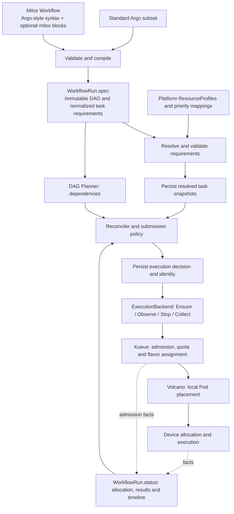

# Planned Milos workflow extensions

Status: long-term design. A narrower native-Pod profile slice is implemented; see [the actual schema, usage and acceptance boundary](profile-authoring.md). Standard Argo import and the additional extensions below remain planned. The schemas below are proposals, not the implemented API; `milos.example.io` remains a placeholder API group.

## Authoring and execution boundaries

Use a Milos-owned `Workflow` document with familiar Argo DAG, template and container syntax. Put every custom authoring field under `milos`: task extensions under `dag.tasks[].milos`, workflow extensions under `spec.milos`. This is structural separation, not compatibility with the Argo controller. Standard Argo documents retain the separate strict [Argo subset contract](argo-subset.md); they must not accept these custom fields silently.

The authoring document is compiled into the existing `WorkflowRun`. A separate installed Workflow CRD/controller is not required for the first compiler: it can accept a document at submission. Persistence, resubmission and lifecycle of authoring objects require a separate decision before exposing them through the Kubernetes API. No CLI command or API endpoint is specified yet.



The diagram shows the proposed local Kueue/Volcano path. Native/default remains available. MultiKueue/default retains its separate remote protocol; MultiKueue/Volcano remains unsupported.

## Planned authoring fields

All fields below are optional extensions, but none is implemented. A compiler must reject a field until its semantics and enforcement are implemented. Do not accept future fields as ignored configuration.

| Location | Field | Contract and business value | Delivery |
| --- | --- | --- | --- |
| Task `milos` | `taskType` | Reporting category: training, evaluation, simulation, or 3dgs. Does not determine priority or hardware automatically. Enables comparable JCT and efficiency reports. | First slice |
| Task `milos.requirements` | `profileRef.name` | One validated, versioned ResourceProfile. Prevents incompatible hardware placement. | First slice |
| Task `milos.scheduling` | `priorityClassRef` | Platform-authorized priority mapped separately to admission and placement classes. Improves urgent-work turnaround without bypassing dependencies. | First slice |
| Task `milos.scheduling` | `estimatedDurationSeconds` | Positive advisory runtime estimate; retain source and confidence when available. Not a timeout or deadline. Enables forecasts before duration-based scheduling is introduced. | First slice |
| Workflow `spec.milos` | `execution` | Explicit supported backend/admission/placement/scheduler configuration, normalized to WorkflowRun.spec.execution. Preserves queue ownership and authorization. | Integration slice |
| Workflow `spec.milos` | `submissionPolicy` | Bounded outstanding work, optionally by platform resource category. Avoids CPU branches being blocked by unrelated GPU waits and limits queue pressure. Exact fields require policy design. | Later |
| Workflow `spec.milos` | `deadline` | Optional end-to-end completion target. Define absolute/relative semantics before implementation; never infer from duration estimates. Enables deadline reporting and future constrained selection. | Later |
| Task `milos.requirements` | `execution` | Typed execution shape, worker roles/counts and per-worker quantities. Requires runtime-backed group lifecycle; not a larger minMember on the existing Pod backend. Enables distributed training. | Later |
| Task `milos.requirements` | `topology` | Required/preferred zone, fabric or subgroup placement with one explicit topology owner. Reduces communication overhead. | Later |
| Task `milos.requirements` | `data` | Required storage access and locality constraints. A location is not proof of availability or replication. Prevents unusable placements and transfer overhead. | Later |
| Task `milos.requirements` | `allowedProfileRefs` | Explicit alternatives, mutually exclusive with a single profileRef; selection objective and fallback rules must be defined. Enables measured hardware selection. | Later |
| Task `milos` | `recovery` | Interruption capability, checkpoint identity/completeness, restore compatibility and bounded recovery. No preemption protection without enforced platform policy. Reduces lost work. | Later |
| Workflow `spec.milos` | `optimization` | Advisory first, then constrained time/cost selection with prediction uncertainty. No mixed-unit score or automatic training-parameter changes. | Later |
| Task `milos` | `artifacts` / `cache` | Typed outputs/checkpoints and explicit safe reuse, covering inputs, code, configuration and side effects. Reduces repeated work. Requires an artifact protocol. | Later |

Later-field names identify reserved design areas, not a finalized schema. Fractional sharing, RDMA device requests, hybrid-parallel topology, automatic migration, priority propagation and safe backfilling require separate enforcement designs and acceptance tests. Workflow urgency must not silently elevate ancestors or unrelated tasks.

## Proposed usage

```yaml
apiVersion: milos.example.io/v1alpha1
kind: Workflow
metadata:
  name: reconstruction
spec:
  entrypoint: pipeline
  templates:
    - name: pipeline
      dag:
        failFast: false
        tasks:
          - name: reconstruct
            template: run-3dgs
            milos:
              taskType: 3dgs
              requirements:
                profileRef:
                  name: rtxpro5000-exclusive-v1
              scheduling:
                priorityClassRef: background
                estimatedDurationSeconds: 7200
    - name: run-3dgs
      container:
        image: example/3dgs:v1
        resources:
          requests:
            cpu: "8"
            memory: 32Gi
          limits:
            nvidia.com/gpu: "1"
```

Container resources specify quantities; the task profile specifies eligible hardware. Bind extensions by DAG task, not template: two tasks may reuse a template with different profiles. Standard Argo dependency, parameter and explicit `failFast: false` restrictions still apply to the initial authoring subset. Unknown fields, duplicate keys and unsupported semantics are errors. No arbitrary PodSpec passthrough or user overrides of generated identity/scheduling metadata.

At compilation, normalize resources to one internal source. For profile-enabled nodes, move authoring container resources into NodeSpec.requirements.resources and clear legacy container.resources. Reject competing internal sources. Normalize extended-resource requests/limits consistently with Kubernetes semantics before digesting. A standalone acceleratorCount shorthand is unnecessary in the initial authoring schema. Duration estimates remain distinct from existing workflow/node timeouts.

## ResourceProfile

Introduce a namespaced, platform-write-only ResourceProfile CRD. Restrict use through deployment policy as well as write permissions. Use immutable specs and versioned names; administrators publish a new resource to change a profile. Profiles define eligibility and request bounds, never live free capacity, reservations or tenant quota. CPU-only profiles omit accelerator fields.

```yaml
apiVersion: milos.example.io/v1alpha1
kind: ResourceProfile
metadata:
  name: rtxpro5000-exclusive-v1
  namespace: ml-workflows
spec:
  executionKinds: [Pod]
  accelerator:
    resourceName: nvidia.com/gpu
    model: rtxpro5000
    minDeviceMemory: 70Gi
    allocationMode: Exclusive
    countRange: {min: 1, max: 8}
  placement:
    nodeSelector:
      accelerator.platform.example/model: rtxpro5000
      accelerator.platform.example/allocation-mode: exclusive
  bounds:
    requests:
      cpu: {min: "1", max: "96"}
      memory: {min: 4Gi, max: 512Gi}
  integrations:
    kueue:
      compatibleFlavorRefs: [rtxpro5000-exclusive]
```

Values and labels are illustrative, not verified cluster inventory. Device memory and exclusivity must map to verified labels and allocation mechanisms; declaring them does not enforce them. ResourceProfile validation status means configuration was verified, not that capacity is currently available. Store validation provenance and observation time. A profile must not manufacture RDMA support, runtime compatibility or device isolation from a name. Reject requirements the chosen backend cannot enforce.

Do not add a ResourcePool CRD initially. Hardware classes, physical isolation boundaries and team quotas are separate concepts. Reuse Node discovery, ResourceFlavors and existing queues. A future pool resource is justified only if Milos manages provisioning, membership or draining.

## Resolution and execution records

1. Validate immutable input and authorization. Resolve every profile-enabled task before allowing any workflow task to start. Missing/invalid profiles produce a field-specific error; never fall back silently.
2. Persist bounded resolved task snapshots in WorkflowRun.status.resolvedTasks. Include profile name/UID/generation/spec digest, compiler version, normalized resources, selectors, tolerations, priority mapping and allowed flavor bindings. Persist the complete compiler output, not only hashes. Enforce snapshot and total object-size limits.
3. When a node is selected for submission, persist NodeStatus.decision with the existing WorkflowUID/NodeID/Attempt/DispatchGeneration identity, resolved-task digest, execution digest, reason and decision timestamp alongside execution intent. No backend create precedes this commit.
4. Build requests from the committed snapshot. Never resolve live profiles again for an existing execution. DefinitionDigest still identifies immutable user input; ExecutionDigest additionally binds compiler output and execution policy. Existing runs retain the legacy digest path.
5. Record observed allocation separately: Workload UID, resource-to-flavor assignments, worker cluster, Pod/Node UIDs, observed hardware labels and verification timestamp. Device UUIDs require trusted device observations; Pod requests alone do not prove device identity.
6. Keep existing IntentRecordedAt, StartedAt, FinishedAt and stage diagnostics. Detailed telemetry and historical decisions belong in external storage, not unbounded CR status.

Profile deletion must not prevent observation, cancellation or cleanup. Configuration drift before resource creation blocks dispatch with a reason rather than silently recompiling. After creation, report mismatches without inventing an automatic eviction/retry protocol. Existing unknown/disconnected execution rules remain in force.

The decision explains allowed hardware and why it was selected; observed allocation records what Kueue and the scheduler actually assigned. Predictions are not allocation facts. Future retries must explicitly define when a new resolution is allowed; no running attempt is mutated in place.

## Kueue and Volcano mapping

| Source | Compiled target / authority |
| --- | --- |
| Workflow execution admission.queueRef | Pod `kueue.x-k8s.io/queue-name`; existing namespaced LocalQueue |
| Normalized resource quantities | Pod resources; Kueue Pod integration owns creation of its Workload |
| Profile node constraints | Pod selectors/tolerations; validate compatibility with ResourceFlavor nodeLabels |
| Profile compatibleFlavorRefs | Validation allowlist, not a direct Kueue flavor-selection command |
| Authorized priority mapping | Kueue `kueue.x-k8s.io/priority-class` and separately Pod/PodGroup priorityClassName |
| Workflow scheduler name | Pod schedulerName; default-scheduler or volcano in supported combinations |
| Workflow Volcano queue | Owned PodGroup.spec.queue |
| Single-Pod execution | Existing owned PodGroup with minMember: 1 and Pod group annotation |
| Group minimum resources, if emitted | Derive from effective Pod requests; no independent conflicting user quantity |
| Actual admission | Read Workload.status.admission PodSet assignments, including flavor per resource |
| Actual placement | Read identity-verified execution Pod and authorized node/device observations |

Kueue remains admission and quota authority. ResourceFlavor describes hardware labels; quota belongs to ClusterQueue resource groups. Milos does not write Workload admission status or remove Kueue gates. Validate that queue configuration plus selectors excludes incompatible flavors; reject ambiguous mappings rather than pretending compatibleFlavorRefs pins a flavor. CPU/memory/GPU may have distinct flavor assignments.

Volcano remains the local placement owner. Configure its queues/preemption consistently with Kueue. Task priority is not permission to bypass dependencies or an assurance against eviction. Topology integration must explicitly select an owner; do not automatically combine Kueue TAS and Volcano topology rules. Exact topology/device features require pinned-version live acceptance.

The new resolver requires read permissions for approved profiles and applicable flavor/priority metadata. Node verification may require additional scoped-by-policy cluster reads; do not assume existing worker credentials include them. Multi-cluster profiles require per-cluster bindings and verified worker capabilities before enabling this path. Preserve current remote UID verification and cleanup behavior.

## Compatibility and implementation boundaries

Without a `milos` block, preserve the supported baseline resources and scheduling defaults. Existing native WorkflowRun submissions remain valid. Missing extensions do not imply a GPU model, team priority or recovery capability. A deployment may explicitly require profiles for selected queues, but that is opt-in policy.

Keep the pure DAG planner independent of profile and scheduler APIs. Add a resolver/compiler in internal/resources; extend NodeSpec and status types, request construction and backend observations. Keep Ensure/Observe/Stop/Collect. Resource-aware submission is a separate change: preserve existing parallelism semantics for old workflows and introduce explicit new policy rather than redefining the field.

For distributed workloads, use a runtime-backed execution group. One owner handles in-execution process recovery; Milos owns workflow-level decisions after confirmed outcomes. The entire DAG is never one gang. Current single-Pod lifecycle and remote cleanup contracts must not be assumed sufficient for TrainJob or JobSet.

## Delivery and acceptance

| Order | Deliverable | Acceptance evidence |
| --- | --- | --- |
| 1 | Strict Milos/Argo authoring compiler, optional milos task block, ResourceProfile resolution and native Pod request generation | Supported DAG/parameter semantics preserved; invalid fields and conflicts rejected; exact hardware constraints compiled; profile changes/deletion cannot alter an intent; restart replay produces the same request; baseline submissions unchanged |
| 2 | Local Kueue/Volcano profile and priority mapping | Real hardware-class/flavor verification; no silent fallback; admission and placement waiting reasons distinguished; cancellation still completes; priority authorization and policy drift checked |
| 3 | Resource-aware submission and mixed-workload evaluation | Training/evaluation/simulation/3DGS trace comparison; independent CPU progress during GPU waits; bounded submissions; no starvation; report JCT, cost and fairness |
| 4 | Distributed runtime, topology and checkpoint contracts | Whole execution lifecycle, worker failure, verified communication path, coordinated stop and bounded recovery |
| 5 | Performance profiles, alternative selection, data/artifact reuse | Prediction uncertainty and equivalent-quality cost/JCT comparison; no unapproved parameter changes or unsafe reuse |

Finish the first vertical slice before automatic selection: one Argo-style Milos task referencing one immutable profile compiles into a durable WorkflowRun and an eligible native Pod, with optional metadata/priority validation and unchanged legacy behavior. Scheduler integrations then validate real admission and placement rather than merely generated YAML.

## References

- [Kueue ResourceFlavor](https://kueue.sigs.k8s.io/v0.20/docs/concepts/resource_flavor/)
- [Kueue workload priority](https://kueue.sigs.k8s.io/v0.20/docs/concepts/workload_priority_class/)
- [Volcano PodGroup](https://volcano.sh/docs/concepts/podgroup/)
- [Execution abstraction](execution-abstraction.md)
- [Scheduling integration boundaries](scheduling-integrations.md)
