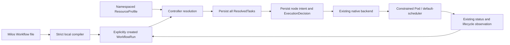

# Native profile authoring

The first resource-aware authoring slice is implemented. `cmd/milos` compiles a Milos-owned Argo-style document to a native `WorkflowRun`; the controller resolves namespaced `ResourceProfile` objects and persists constraints before dispatch. This is not an Argo controller integration or standard Argo importer.

## Usage

Build with `make build`. Review and install the CRDs and controller using the [deployment guide](../deploy/README.md). The ResourceProfile CRD is included by `config/crd` and `deploy/crds`; the controller receives read-only profile access. Profile creation/update permissions belong to platform administrators, not ordinary workflow submitters. All profiles in the execution namespace are available to that namespace's workflow submitters in this first version. Use namespace boundaries for profile access; per-queue authorization is future work.

The following are operator instructions, not actions performed by compilation:

```sh
# First adapt the example labels to verified hardware and device-plugin settings.
kubectl --context YOUR_CONTEXT -n YOUR_NAMESPACE apply -f examples/milos/resourceprofile.yaml

# Local compilation performs no cluster access or writes.
bin/milos --file examples/milos/profile-workflow.yaml --namespace YOUR_NAMESPACE > /tmp/workflowrun.yaml

# Inspect the compiled definition before explicitly submitting it.
kubectl --context YOUR_CONTEXT create --validate=strict -f /tmp/workflowrun.yaml
kubectl --context YOUR_CONTEXT -n YOUR_NAMESPACE get workflowrun hardware-example -o yaml
```

Use a new explicit workflow name for each execution. The compiler does not install a Workflow CRD; applying its authoring input directly is unsupported. The sample container is a placement smoke test, not a GPU performance benchmark. No hardware labels or exclusive device configuration are created automatically.

## Supported authoring contract

The only input GVK is `milos.example.io/v1alpha1, Workflow`. Require explicit metadata.name, optional matching namespace, one entrypoint DAG, container templates, task names/template references/dependencies, and explicit `failFast: false`. Optional spec fields are parallelism, volumes, serviceAccountName and imagePullSecrets. Container fields use the existing Milos ContainerSpec allowlist. The initial compiler rejects parameters/interpolation, generateName, metadata labels/annotations, nested DAGs and standard Argo input; these remain planned rather than silently approximated.

The only custom authoring field currently accepted is:

```yaml
milos:
  requirements:
    profileRef:
      name: h20-exclusive-v1
```

Task type, scheduling priority, duration estimates, workflow extensions and distributed fields remain rejected. Unknown fields, duplicate YAML keys, multiple documents, anchors/aliases, custom tags, excessive nesting, conflicting namespaces, missing templates, cycles and invalid resource bounds fail validation. Input is limited to 256 KiB and DAGs to 128 nodes. Resource references are static.

Quantities remain in `container.resources` in both authoring and the native NodeSpec. This intentionally uses one existing resource source instead of adding a duplicate requirements.resources field. The resolver snapshots normalized resources, including requests defaulted from limits. Profile-enabled extended resources require equal integer requests and limits. Legacy nodes retain the original request-construction path.

## Implemented ResourceProfile schema

Use the concrete sample [resourceprofile.yaml](../examples/milos/resourceprofile.yaml). The schema is deliberately narrower than the long-term design:

- `spec.nodeSelector`: 1–32 exact, validated label pairs.
- `spec.tolerations`: up to 16 explicit-key Equal/Exists scheduling tolerations; no NoExecute or timed eviction behavior.
- `spec.resourceBounds`: per-resource minimum and maximum effective requests; limits cannot exceed maximum bounds. Bounds validate quantities, not device capacity or quota.
- Spec is immutable through CRD validation. Publish a new versioned name to change constraints.

The profile does not claim to discover GPU memory, prove exclusivity, validate a communication path or reserve capacity. Platform operators must verify selector labels and device allocation configuration. No discovery/status controller is included. An absent matching node produces normal scheduling waits rather than fallback.

## Durable execution



`status.resolvedTasks` pins profile name, UID, generation, compiler version, constraints and normalized resources with a digest. Every required profile resolves before the workflow is accepted; one missing profile blocks all execution. The controller polls invalid active workflows, so publishing a missing profile can unblock them.

`status.nodes[name].decision` binds the snapshot to the definition digest and existing WorkflowUID/NodeID/Attempt/DispatchGeneration identity. It is saved with intent before Pod creation. Subsequent reconciles verify snapshot and decision hashes and reconstruct Pod requests from persisted data, without reading the live profile again. Profile deletion/recreation cannot alter an accepted snapshot or block cancellation. Status write access remains trusted controller authority, not a security boundary provided by hashes.

Existing workflow/node timeout and cancellation behavior remains intact. DefinitionDigest and the legacy execution digest are unchanged for nodes without requirements. Profiles are restricted to local native-pod/default-scheduler for now; Kueue/Volcano profile mapping and observed hardware verification are future work. Current Pod identity checks and ordinary Pod status establish execution facts, not physical GPU identity.

## Validation

Validation completed with `make build`, `make test` (race detector), `make vet`, and `make test-integration`.

Unit tests cover strict compilation, missing profiles, bounds, normalization, corrupt snapshots and legacy omission. The isolated API test creates a profile and compiled WorkflowRun, verifies profile immutability, deletes the profile after resolution, reconstructs the reconciler for every step, checks Pod selectors/GPU requests and stable UID, then confirms cancellation. The test does not run a scheduler, kubelet or GPU container; physical hardware placement requires separate live acceptance.

See [planned extensions](milos-extensions.md) for later capabilities and Kueue/Volcano mappings.
