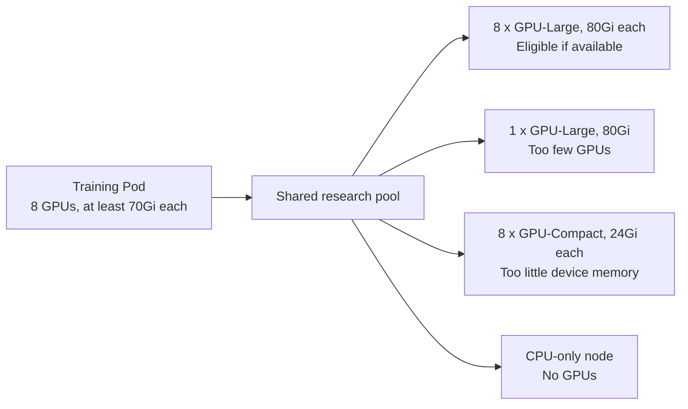
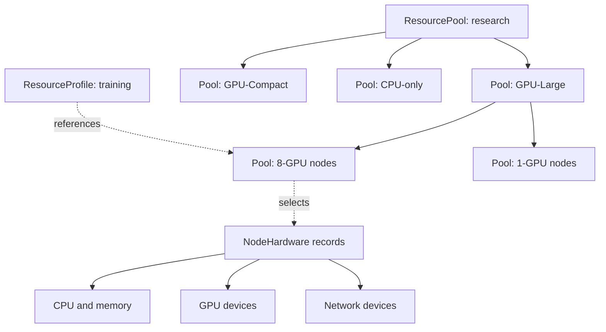
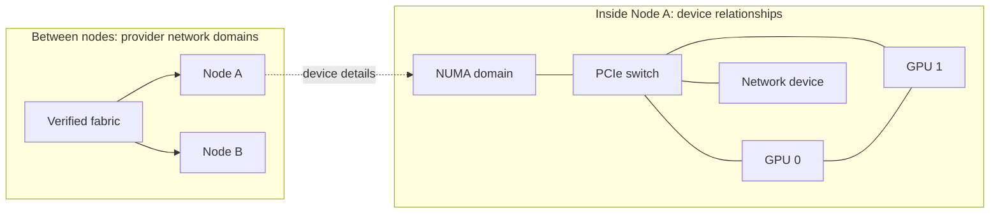
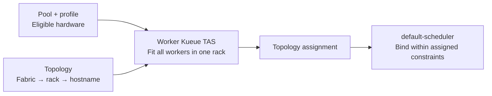
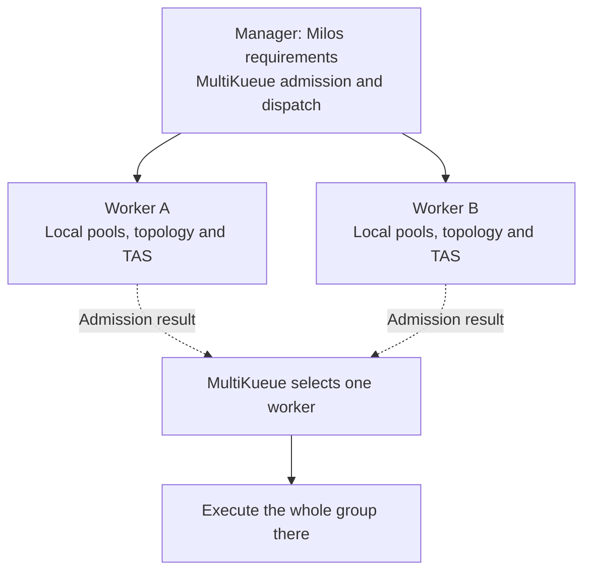
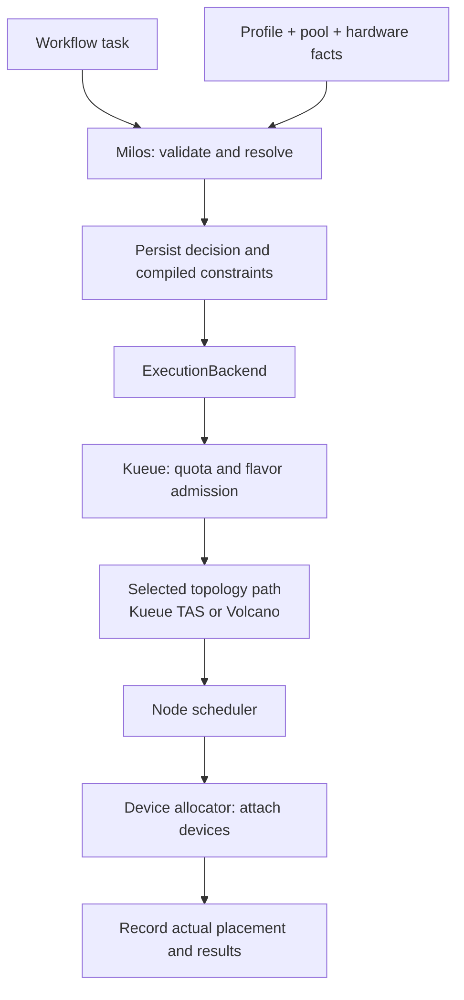

# Resource pools and hardware-aware placement

**Status: proposed, not implemented.** The current ResourceProfile path supports native Pods with default-scheduler. The pools, hardware fields and integrations below are future work; the YAML is illustrative, not installable.

The goal is to match each workflow stage to suitable hardware, then improve completion time and cost through measured scheduling policies.

## Example: a shared pool with incompatible placement choices

Consider a fictional team with four kinds of nodes. GPU-Large and GPU-Compact are placeholder models; all values below are synthetic.

A training Pod needs eight compatible GPUs, each with at least 70Gi of memory. A shared team label cannot identify the right nodes:



Evaluation may need only one 16Gi GPU, while simulation may need CPUs and host memory. Their profiles should allow different hardware. Packing small GPU jobs can preserve whole eight-GPU nodes for training, but must be evaluated for fairness and waiting time.

**Idea:** describe hardware once, group it into pools, and let profiles express what a task may use. The scheduler still chooses the actual placement.

## Resource hierarchy



Pools select inventory records; they do not copy nodes or devices into a nested YAML tree. Operators only create the levels they need.

| Concept | Question it answers | Owner |
| --- | --- | --- |
| ResourcePool | Which hardware belongs to this group? | Platform administrator; controller computes membership |
| NodeHardware | What hardware exists on this node? | Discovery/import controller |
| ResourceProfile | What hardware may this task use? | Platform administrator |
| Task requirements | Which profile and resource quantities does this stage need? | Workflow author |
| Execution decision | What constraints did Milos commit, and why? | Milos controller |
| Actual allocation | Which nodes and devices were assigned? | Scheduler and device allocator |

ResourcePool and NodeHardware are cluster-scoped within one execution cluster. ResourceProfile remains namespaced with an immutable spec.

## ResourcePool model

A child inherits its parent's membership and narrows it:

```text
Child members = parent members ∩ node selector ∩ hardware requirements
```

The example defines an organizational pool, a hardware class and a node shape:

```yaml
# Proposed API. Model names and labels are fictional.
apiVersion: milos.example.io/v1alpha1
kind: ResourcePool
metadata:
  name: research
spec:
  membership:
    nodeSelector:
      matchLabels:
        platform.example/team: research
---
apiVersion: milos.example.io/v1alpha1
kind: ResourcePool
metadata:
  name: research-gpu-large
spec:
  parentRef:
    name: research
  membership:
    nodeSelector:
      matchLabels:
        accelerator.platform.example/model: gpu-large
---
apiVersion: milos.example.io/v1alpha1
kind: ResourcePool
metadata:
  name: research-gpu-large-8gpu
spec:
  parentRef:
    name: research-gpu-large
  membership:
    hardware:
      gpu:
        physicalCount: {min: 8, max: 8}
```

Keep these rules explicit:

- One parent per pool; reject cycles, missing parents and invalid predicates. Required unknown hardware facts do not match.
- Pools can overlap. Count each physical node/device once in aggregate summaries; GPU partitions do not create additional physical GPUs.
- Parentage inherits membership only. It does not create quotas, priority, isolation or eviction rights.
- Show capacity by model and node shape, with observation time. Eight free GPUs scattered across nodes cannot satisfy one eight-GPU Pod.
- Scheduler allocations and quota remain authoritative in their existing components. Low utilization does not mean a device is unallocated.

Pool status should contain bounded counts, membership revision and freshness/conflict conditions. Keep detailed inventory separately queryable.

## Hardware and topology

NodeHardware references a Node by name and UID. Discovery writes its observed status; a replaced Node must not inherit the old inventory.

| Information | Examples |
| --- | --- |
| Identity and evidence | Node UID, device IDs, source, observation time, inventory revision |
| CPU and memory | Architecture, sockets, cores, NUMA domains, host memory |
| Devices | GPU model, per-device memory, health, partitions, network devices |
| Connectivity | PCIe links, GPU links, GPU/NIC locality, network-domain references |
| Allocation interface | Device-plugin resource names or allocator/DRA references |

Unknown facts stay unknown. Hardware labels need trusted writers; device memory, exclusivity and application compatibility need verification.

**Pool hierarchy describes membership. Topology describes connectivity.** Two nodes in the same pool may be far apart on the network.



This is an illustrative topology, not an inferred hardware layout. Store local device relationships as a graph. Use Kueue Topology or Volcano HyperNode for inter-node placement; defer a separate Milos HardwareTopology CRD.

A **required** topology constraint must be enforced or block execution. A **preferred** constraint may be relaxed with an explanation. Device locality needs allocator support: choosing a node does not guarantee a particular GPU/NIC pair. Inter-node constraints apply to an explicit distributed execution group, never the whole DAG.

## Network resources

Keep three kinds of network information separate:

| Layer | Example | Representation |
| --- | --- | --- |
| Connectivity | Same fabric or rack | Verified node labels and provider topology |
| Device capability and allocation | RDMA support, NIC/VF, GPU/NIC locality | NodeHardware observations plus device-plugin requests or DRA claims |
| Performance | Link speed, measured throughput, reserved bandwidth | Sourced inventory/telemetry; guarantees need a reservation and enforcement mechanism |

```yaml
# Proposed NodeHardware status fragment; fictional values.
status:
  devices:
    - id: nic-0
      kind: Network
      numaNode: 0
      network:
        fabricID: fabric-a
        rdmaCapable: true
        linkSpeedBitsPerSecond: 200000000000
      allocation:
        resourceName: example.com/rdma
        mode: Shared
```

Record source, observation time and health with these facts. A profile may require RDMA capability, minimum advertised link speed and supported locality. These proposed requirements must compile to enforceable constraints. Actual device quantities stay in container resources, for example:

```yaml
# Pod container fragment; requires a matching installed device plugin.
resources:
  requests:
    example.com/rdma: "1"
  limits:
    example.com/rdma: "1"
```

The plugin defines the resource unit. One shared RDMA unit need not mean one dedicated NIC; network attachment must also be configured where required. A 200 Gbit/s link and same-rack placement do not guarantee 200 Gbit/s application throughput. Defer guaranteed-bandwidth fields until a provider can reserve and enforce them. [Shared RDMA plugin](https://github.com/Mellanox/k8s-rdma-shared-dev-plugin)

DRA is an optional alternative, not an initial dependency. Kueue v0.20 TAS device-feasibility support for DRA is alpha and disabled by default; validate the driver and feature gates separately. [TAS with DRA](https://kueue.sigs.k8s.io/v0.20/docs/concepts/topology_aware_scheduling/)

## Kueue TAS and MultiKueue

ResourcePool determines eligible hardware. TAS finds a topology placement within it. For a future group of four workers, each requesting eight GPUs, Milos can require all workers to fit within one rack.



Platform configuration connects a flavor to the topology; pool eligibility must also be enforced in the generated workload:

```yaml
# Illustrative Kueue v0.20 configuration, not a complete deployment.
apiVersion: kueue.x-k8s.io/v1beta2
kind: Topology
metadata:
  name: training-network
spec:
  levels:
    - nodeLabel: topology.example.com/fabric
    - nodeLabel: topology.example.com/rack
    - nodeLabel: kubernetes.io/hostname
---
apiVersion: kueue.x-k8s.io/v1beta2
kind: ResourceFlavor
metadata:
  name: gpu-large-tas
spec:
  nodeLabels:
    accelerator.platform.example/model: gpu-large
  topologyName: training-network
```

Use verified hierarchical labels. A model selector alone does not enforce team-pool membership. Milos translates a same-rack requirement into the supported runtime's Pod-template annotation:

```yaml
# Pod-template metadata fragment, not top-level Job metadata.
metadata:
  annotations:
    kueue.x-k8s.io/podset-required-topology: topology.example.com/rack
```

The preferred variant is `podset-preferred-topology`. Constraints apply to a PodSet; multiple roles need explicit PodSet grouping when they must share a domain. Milos must validate the mapping, enabled features and resulting assignment rather than assume an annotation was honored. Current one-Pod tasks cannot express this distributed group. [TAS workload setup](https://kueue.sigs.k8s.io/v0.20/docs/tasks/run/topology_aware_scheduling/)

With MultiKueue, topology assignment stays in the worker cluster:



Configure worker topology and manager-side delayed topology requests following the pinned upstream setup. Use approved per-worker pool/flavor bindings and consistent topology-label meanings. Do not use manager nodes to calculate remote placement or split one tightly coupled group across clusters. Upstream TAS + MultiKueue support exists since v0.15; Milos integration remains planned. [MultiKueue setup](https://kueue.sigs.k8s.io/v0.20/docs/tasks/manage/setup_multikueue/), [version support](https://kueue.sigs.k8s.io/v0.20/docs/tasks/dev/setup_multikueue_development_environment/)

Keep the committed requirements separate from the observed worker cluster, Workload UID and topology assignment. TAS may revise assignments during supported node replacement. Before enabling recovery, define how the runtime and Milos verify replacement identities and cleanup; do not silently adopt a new Pod or add a competing retry owner.

## ResourceProfile and task integration

A future profile selects the eight-GPU pool and adds workload constraints:

```yaml
# Proposed extension; example.com/gpu is a placeholder resource name.
apiVersion: milos.example.io/v1alpha1
kind: ResourceProfile
metadata:
  name: gpu-large-8gpu-v2
  namespace: ml-workflows
spec:
  poolRef:
    name: research-gpu-large-8gpu
  nodeSelector:
    accelerator.platform.example/model: gpu-large
  resourceBounds:
    example.com/gpu: {min: "8", max: "8"}
  hardware:
    gpu:
      minDeviceMemory: 70Gi
      allocationMode: exclusive
  inventoryPolicy:
    requiredFacts: [gpuModel, physicalGpuCount, deviceMemory, allocationMode]
    maxAge: 5m
```

The workflow keeps its existing interface:

```yaml
milos:
  requirements:
    profileRef:
      name: gpu-large-8gpu-v2
```

Resource quantities stay in `container.resources`. Pool membership, profile constraints and task requirements intersect; none overrides another. GPU exclusivity does not imply exclusive ownership of the whole node.

## Resolution, enforcement and restart safety



This shows the planned local integration paths. Native/default remains available. The DAG planner still handles dependencies and parallelism; backend lifecycle stays `Ensure / Observe / Stop / Collect`. Profile-aware TAS/MultiKueue integration and MultiKueue/Volcano remain unsupported today.

1. **Validate:** authorize profile use; check pool references, fresh required facts and backend capabilities. Reject unsupported requirements.
2. **Commit:** persist profile/pool identities, policy revisions, compiled constraints and reasons before creating execution resources. Keep full inventory graphs outside WorkflowRun.
3. **Enforce:** carry the constraints into scheduling. Checking inventory only at submission is insufficient. Selectors/affinity or a scheduler integration must prevent out-of-pool placement.
4. **Recover:** replay the committed decision after restart. Incompatible policy drift blocks dispatch instead of silently choosing different hardware.
5. **Observe:** record actual nodes/devices separately from intent. Keep cancellation working through stored execution handles if inventory or profiles disappear.

**Implementation gate:** define how revisioned pool policy is enforced while membership changes. Mutable pool-name labels alone are insufficient. Protect label writers, handle node replacement and test the race between discovery, Pod creation and binding. Initial guarantees apply at scheduling time; later drift is reported without automatic eviction or migration.

## Scheduler boundaries

| Component | Responsibility |
| --- | --- |
| Milos | Requirements, eligible hardware, durable decisions and workflow lifecycle |
| Kueue | Quota, admission and flavor assignment; TAS additionally computes topology assignment |
| MultiKueue | Remote dispatch to a worker cluster; worker TAS computes local placement |
| Volcano or default-scheduler | Node binding; topology ownership follows the selected path below |
| Device allocator | Device assignment and isolation |

| Planned path | Topology owner | Node scheduler |
| --- | --- | --- |
| Local Kueue TAS, then worker TAS with MultiKueue | Kueue Topology and topology assignment | Initially default-scheduler |
| Local Kueue admission with Volcano topology | Volcano HyperNode and placement policy | Volcano |

Choose one path; do not stack independent TAS and Volcano topology decisions. Validate mappings against pinned versions. Pool hierarchy does not automatically map to queue or Cohort hierarchy.

Pool access is not tenant authorization. Keep profile/queue access checks and trusted inventory writes separate. Multi-cluster pools require per-worker identities and bindings in a later design.

## Delivery roadmap and acceptance

| Stage | Build | Value | Verify |
| --- | --- | --- | --- |
| H1 | Hardware/network inventory and pool membership | Understand hardware shapes and network capabilities | Freshness, unknown connectivity, cycles, overlap deduplication and CPU-only nodes |
| H2 | Pool-backed native profiles | Prevent incompatible placement | Real placement, restart recovery, membership drift and unchanged legacy behavior |
| H3 | Local profile/flavor mapping and TAS configuration; Volcano as an alternative | Explain admission and placement waits | Pool enforcement, topology labels/gates, no quota bypass and cancellation |
| H4a | Execution groups with local TAS and network-device allocation | Reduce communication overhead | PodSet grouping, required/preferred locality, device attachment, transport and recovery |
| H4b | MultiKueue with worker-side TAS | Use suitable capacity in another cluster | Per-worker bindings, single-cluster group execution, remote assignment/identity and outage cleanup |
| H5 | Recommendations, then constrained automatic selection | Improve completion time and cost fairly | Comparable workload quality, small-job latency, large-job waiting and recovery cost |

**Start with H1, then a narrow H2 native path.** Basic model and node-shape selection does not require complete GPU/NIC topology discovery.

Validate local TAS group execution before MultiKueue TAS. Test insufficient same-rack capacity, disabled/incorrect TAS annotations, unavailable RDMA resources, node replacement and worker loss. Bandwidth guarantees remain out of scope; compare measured throughput and end-to-end completion time.

Evaluate training, evaluation, simulation and 3DGS by stage. Measure useful completion and cost, not only GPU utilization. API tests cover contracts and recovery; live tests must establish actual hardware placement, device attachment and communication behavior.

## Compatibility and remaining decisions

Existing profiles without `poolRef` and workflows without extensions keep their current behavior and require no new controllers or permissions. Profiles remain immutable; unsupported fields remain errors. Apply the same validation to direct WorkflowRun submissions and compiled authoring.

Before implementation, settle policy-revision enforcement, freshness/source precedence, schema and snapshot limits, deletion/retention and RBAC. Test missing/recreated objects, stale facts, unsupported topology, restart/create races, cancellation after inventory deletion and repeated-profile snapshot size.

Provisioning, draining, automatic migration, a new quota ledger and a new device allocator are outside the initial scope.

## Related designs and references

- [Workflow extensions](milos-extensions.md), [execution architecture](design.md) and [current profile usage](profile-authoring.md).
- [Kubernetes DRA](https://kubernetes.io/docs/concepts/resource-management/dynamic-resource-allocation/dra-api/): separate inventory, classes and claims.
- [Koordinator Device](https://koordinator.sh/docs/architecture/device): device inventory and local topology.
- [Volcano topology](https://volcano.sh/docs/userguide/user_guide_how_to_use_network_topology_aware_scheduling/): network domains and hard/soft locality.
- [Kueue Topology](https://kueue.sigs.k8s.io/v0.20/docs/concepts/topology/) and [ClusterQueue](https://kueue.sigs.k8s.io/v0.20/docs/concepts/cluster_queue/): separate topology and quota.
- [KAI topology](https://github.com/kai-scheduler/KAI-Scheduler/blob/main/docs/topology/README.md): required/preferred placement and packing.
- [Slurm GRES](https://slurm.schedmd.com/gres.html) and [topology](https://slurm.schedmd.com/topology.html): typed devices and network-aware placement.
