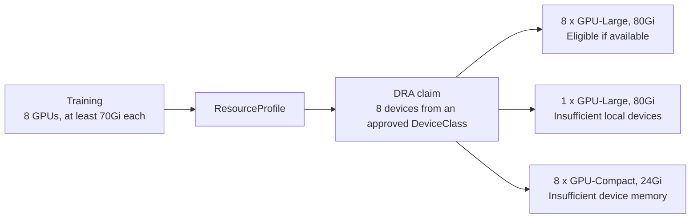
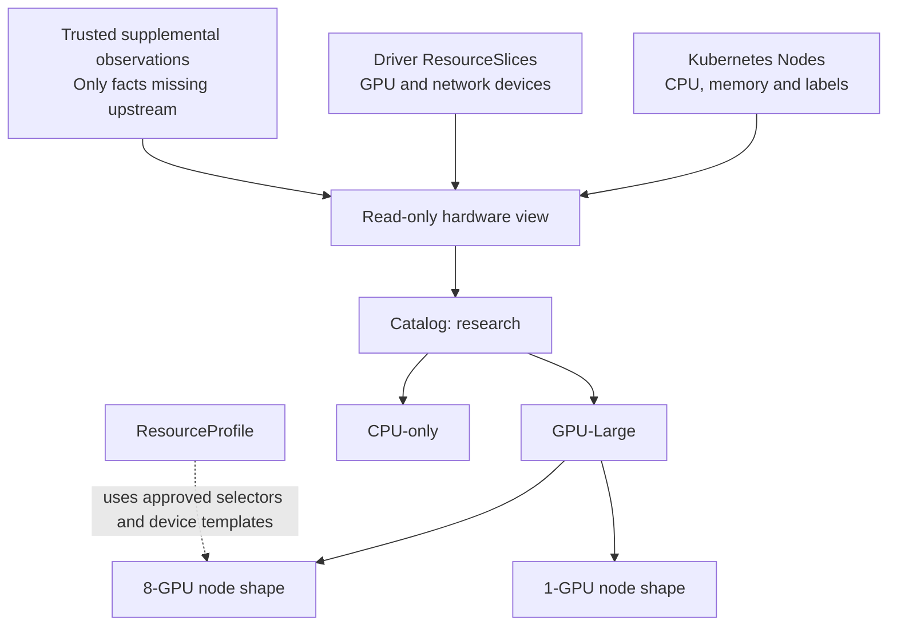
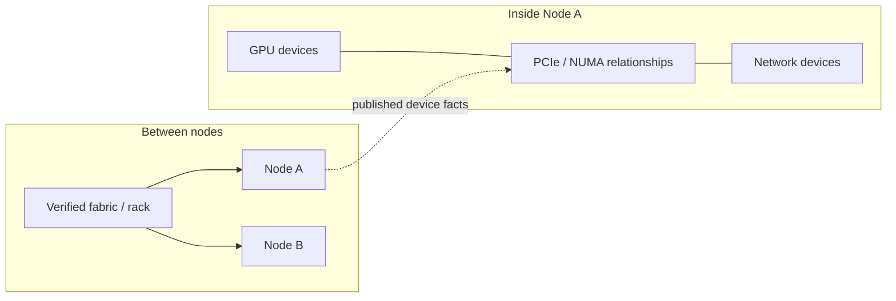
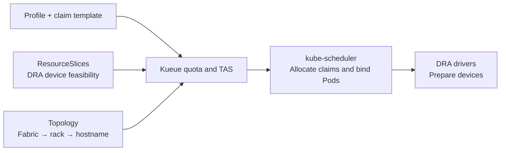
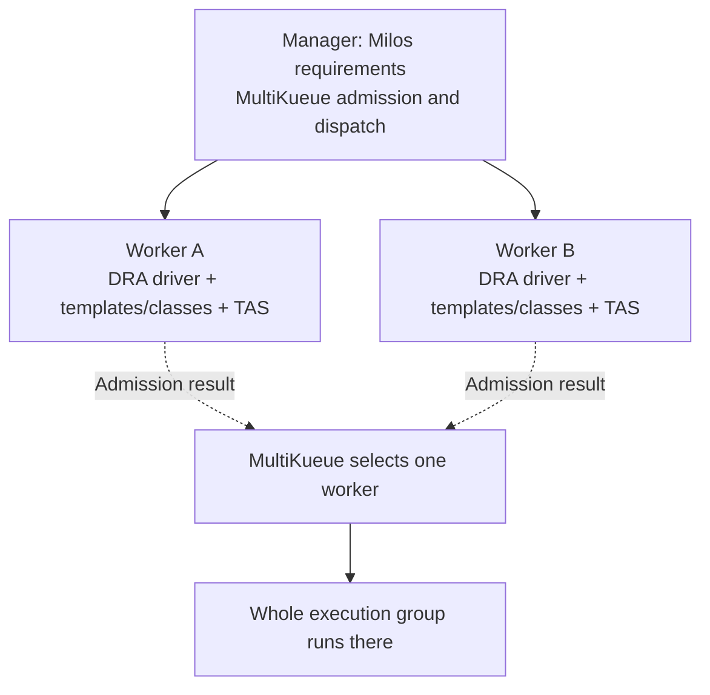

# DRA-backed resource profiles and hardware-aware placement

**Status: proposed, not implemented.** Current ResourceProfiles use native Pods, selectors and device-plugin resources. This design makes Kubernetes Dynamic Resource Allocation (DRA) the preferred device path for new profiles, while preserving the existing path. Examples use fictional hardware and are not deployment instructions.

Milos owns workflow requirements and durable execution decisions. Kubernetes and device drivers own device inventory and allocation. Hierarchical pools remain lightweight catalog views; standalone ResourcePool and NodeHardware CRDs are deferred.

## Example: a shared pool with incompatible placement choices

A training Pod needs eight compatible GPUs with at least 70Gi memory each. The fictional team has several node shapes:



Assume these GPUs are node-local and the application supports the selected devices. DRA checks actual device eligibility; Milos adds approved node selection, CPU/memory bounds and workflow policy. Evaluation may use one smaller GPU, simulation may use only CPUs, and 3DGS can select different profiles for preparation and training.

## Responsibilities

| Concept | Responsibility | Authority |
| --- | --- | --- |
| ResourceSlice | Published devices, attributes and accessibility | DRA driver |
| DeviceClass | Reusable device selection | Platform administrator |
| ResourceClaimTemplate / ResourceClaim | Device request and actual allocation | Platform template policy; Kubernetes claim controllers and scheduler |
| ResourceProfile | Approved device-template reference, node constraints, CPU/memory bounds and guidance | Milos platform administrator |
| Hardware/pool view | Browse and aggregate existing inventory | Read-only Milos projection |
| WorkflowRun decision | Committed request, identities and explanation | Milos controller |
| Quota and topology | Admission, flavor and domain placement | Kueue/TAS or the selected scheduler integration |

DRA pools are driver inventory groups, not organizational pool hierarchies. Milos must not edit ResourceSlices or create a second device-allocation ledger. [DRA API objects](https://kubernetes.io/docs/concepts/resource-management/dynamic-resource-allocation/dra-api/)

## Resource hierarchy



Start with a query/catalog view over Nodes, ResourceSlices and approved classes. Hierarchy is for browsing, reporting and reusable selection, not another physical inventory. A future persisted ResourcePool is justified only if membership policy needs its own lifecycle. A future NodeHardware object, if needed, is a projection or supplemental source, never an independently editable copy of driver-owned device facts.

## ResourcePool model

For catalog groups, child selection narrows the parent:

```text
Child view = parent view ∩ node predicates ∩ published device attributes
```

- Count physical identities once across overlapping views. Partitions and shared devices must not inflate physical GPU totals; report unknown totals when the provider lacks that identity.
- Keep CPU-only nodes visible. Distinguish physical capacity, allocatable resources, allocations and utilization.
- Record source, revision and freshness. Incomplete ResourceSlice pool generations must not produce confident eligibility summaries.
- A view is not a reservation, quota or permission boundary. Enforce approved node predicates and device selectors in the compiled request.
- No `poolRef` or new pool CRD is required for the first DRA slice. Add reusable pool policy only when a view alone is insufficient.

Device identity includes execution cluster, driver, driver pool and device name; node identity includes Node UID. Do not assume every device is local to exactly one node. Detailed hardware graphs stay outside WorkflowRun.

## ResourceProfile and task integration

Use a platform-approved, versioned DeviceClass that selects the desired GPU model and at least 70Gi of device memory from driver-published attributes. Attribute names and isolation semantics depend on the driver. A class name alone is not proof of compatibility or exclusivity.

The administrator publishes a namespaced claim template. The fixed device count has one source:

```yaml
# Illustrative Kubernetes DRA template; requires a validated driver and class.
apiVersion: resource.k8s.io/v1
kind: ResourceClaimTemplate
metadata:
  name: gpu-large-8-v1
  namespace: ml-workflows
spec:
  spec:
    devices:
      requests:
        - name: gpu
          exactly:
            deviceClassName: gpu-large-70gi-v1
            allocationMode: ExactCount
            count: 8
```

A proposed Milos profile references that template:

```yaml
# Proposed Milos fields; not accepted by the current implementation.
apiVersion: milos.example.io/v1alpha1
kind: ResourceProfile
metadata:
  name: research-training-v2
  namespace: ml-workflows
spec:
  nodeSelector:
    platform.example/team: research
  resourceBounds:
    cpu: {min: "8", max: "64"}
    memory: {min: 32Gi, max: 256Gi}
  allocation:
    provider: DRA
    claimTemplateRef:
      name: gpu-large-8-v1
```

The workflow still selects `milos.requirements.profileRef.name`. CPU and host-memory quantities remain in `container.resources`. For this DRA profile, device quantities come only from the referenced template; reject a duplicate GPU extended-resource request. Variable device counts are a later authoring decision, not an implicit override.

The future compiler adds Pod and container claim references:

```yaml
# Generated Pod spec fragment; application fields omitted.
resourceClaims:
  - name: devices
    resourceClaimTemplateName: gpu-large-8-v1
containers:
  - name: main
    resources:
      requests:
        cpu: "8"
        memory: 32Gi
      claims:
        - name: devices
```

Start with per-Pod template-generated claims, exact counts and no cross-Pod claim sharing. The template and DeviceClass remain platform-owned; Milos does not mutate them during a run. Existing device-plugin profiles retain their existing resource quantities and behavior. Allocation provider selection is explicit: never silently fall back from a failed DRA request to a device plugin or request the same devices through both paths.

## Hardware and topology

Device-locality information comes from driver attributes and trusted supplemental observations. Network domains come from verified topology labels/provider data. Unknown connectivity remains unknown.



Use Kueue Topology or Volcano HyperNode for inter-node placement. Required locality must be enforceable; preferred locality may relax with an explanation. Device-level GPU/NIC alignment also needs compatible DRA driver, scheduler and admission support. Inter-node constraints apply to an explicit execution group, never the whole workflow DAG.

## Network resources

| Layer | Representation | Limit |
| --- | --- | --- |
| Connectivity | Fabric/rack labels and provider topology | Common pool membership does not prove proximity |
| Device capability and allocation | Driver attributes, DeviceClass and DRA claim requests | RDMA capability does not configure network attachment by itself |
| Performance | Advertised link speed and measured throughput with provenance | Neither link speed nor locality guarantees bandwidth |

A future GPU/network template may add a network request alongside its GPU request:

```yaml
# Additional entry under ResourceClaimTemplate.spec.spec.devices.requests.
name: network
exactly:
  deviceClassName: rdma-network-v1
  allocationMode: ExactCount
  count: 1
```

The class/driver define whether one allocation is a NIC, VF or shared access. Network attachment and transport configuration must be validated separately. Keep guaranteed-bandwidth fields deferred until a provider reserves and enforces them. The explicit device-plugin compatibility path remains available where DRA is unsupported, with one allocator responsible for each physical device set.

## Kueue TAS and MultiKueue

DRA-backed profiles select eligible devices. TAS selects a topology assignment for the execution group. For example, four workers can each request eight GPUs and require one shared rack:



Platform configuration connects a ResourceFlavor to a topology:

```yaml
# Illustrative Kueue configuration; quotas and driver setup omitted.
apiVersion: kueue.x-k8s.io/v1beta2
kind: Topology
metadata:
  name: training-network
spec:
  levels:
    - nodeLabel: topology.example.com/fabric
    - nodeLabel: topology.example.com/rack
    - nodeLabel: kubernetes.io/hostname
---
apiVersion: kueue.x-k8s.io/v1beta2
kind: ResourceFlavor
metadata:
  name: research-tas
spec:
  nodeLabels:
    platform.example/team: research
  topologyName: training-network
```

Milos translates required same-rack placement into supported runtime Pod-template metadata:

```yaml
metadata:
  annotations:
    kueue.x-k8s.io/podset-required-topology: topology.example.com/rack
```

The preferred annotation is `podset-preferred-topology`. Constraints apply to a PodSet; multiple roles may require explicit PodSet grouping. Validate annotations, enabled features and resulting assignments. [TAS setup](https://kueue.sigs.k8s.io/v0.20/docs/tasks/run/topology_aware_scheduling/)

For the Kueue v0.20 reference path, TAS DRA feasibility is alpha and off by default. It checks fit but does not reserve devices. Start with ResourceClaimTemplates and exact counts; device constraints/configuration and direct claim references have integration restrictions. Reject unsupported GPU/NIC affinity rather than silently dropping it. Pin Kubernetes, Kueue, driver and feature-gate combinations before enabling this path. [Kueue DRA support and limits](https://kueue.sigs.k8s.io/v0.20/docs/concepts/dynamic_resource_allocation/)

With MultiKueue, actual device allocation and topology assignment happen in the execution worker:



Administrators must provision approved DeviceClasses and ResourceClaimTemplates on every eligible worker; MultiKueue does not synchronize these objects automatically. The dispatched template names must resolve locally to validated contracts, not merely matching names. Worker-specific UIDs and driver mappings are recorded separately. [Kueue MultiKueue/DRA integration](https://kueue.sigs.k8s.io/v0.20/docs/concepts/dynamic_resource_allocation/)

Use worker topology and manager delayed topology requests following the pinned [MultiKueue TAS setup](https://kueue.sigs.k8s.io/v0.20/docs/tasks/manage/setup_multikueue/). Manager-side control objects must not allocate devices or execute application containers; test this for the selected runtime. Do not allocate remote devices from manager inventory or split a tightly coupled group across clusters. Local TAS groups must pass before the remote path is enabled.

## Resolution, enforcement and restart safety

1. **Validate:** authorize the profile/template/class, provider, node predicates and supported API/driver features. Read trusted inventory for explanations, not reservations.
2. **Commit:** persist normalized Pod claim references, template/class identities and policy digests, compiled node constraints and request content before resource creation. Keep snapshots bounded.
3. **Allocate:** Kubernetes creates per-Pod claims and owns their allocation; Milos observes claim UIDs, allocation results and Pod identities. Never write claim allocation status or ResourceSlices.
4. **Recover:** replay the committed request after restart. Incompatible policy drift or replaced objects blocks new dispatch; do not silently adopt a different claim or reselect devices.
5. **Stop:** stop owned execution first, then observe claim release/cleanup through the Kubernetes/driver lifecycle. Do not force-remove protection finalizers or release devices while consumers may still run. Shared platform templates/classes are never deleted by run cleanup.

**Implementation gate:** versioned names and snapshots alone do not freeze live DeviceClasses or templates. Platform admission policy must prevent in-place edits and delete/recreate while referenced by active runs; validate this contract before enabling DRA profiles. Policy references are immutable for an attempt, while scheduler-owned allocations can change under explicitly supported runtime recovery. TAS node replacement requires separate identity and cleanup acceptance, not relaxed checks.

Generated claims must be tracked through uncertain Create results, controller restart, failed allocation and Pod deletion. Remote cleanup must also verify worker claim lifecycle, without adding automatic worker writes or a competing retry owner. Missing policy objects must not prevent stopping already identified execution resources.

## Scheduler boundaries

| Planned path | Topology owner | Device allocation |
| --- | --- | --- |
| Local TAS, then MultiKueue worker TAS | Kueue | Initially kube-scheduler and DRA drivers |
| Alternative local Volcano topology | Volcano | Only a separately validated DRA integration or explicit device-plugin path |
| Existing native/default | Existing Pod constraints | Existing device-plugin path, unchanged |

Choose one topology owner and one allocation path per device set. Do not advertise the same physical hardware through independent DRA/device-plugin allocators without coordinated ownership. Pool views do not grant tenant access or create quotas.

The pure DAG planner and `Ensure / Observe / Stop / Collect` remain unchanged in responsibility. Claim lifecycle belongs in execution adapters. DRA support, distributed groups and profile-aware TAS/MultiKueue are planned; existing scheduling-adapter support does not establish their correctness.

## Delivery roadmap and acceptance

| Stage | Build | Value | Verify |
| --- | --- | --- | --- |
| H1 | Read-only Node/ResourceSlice catalog and hierarchical views | Reuse trusted inventory without another device database | Driver coverage, identity, freshness, deduplication and CPU-only views |
| H2 | DRA-backed native profiles using approved claim templates | Simple workflow interface with device-level allocation | Immutable policy contract, claim identity/cleanup, restart recovery and unchanged legacy path |
| H3 | Kueue DRA quota mapping and local TAS feasibility | Explain admission versus device fit | Exact-count/template compatibility, feature gates, no quota bypass and waiting reasons |
| H4a | Execution groups, local TAS and network-device claims | Improve communication locality | PodSet grouping, required/preferred placement, attachment/transport and recovery |
| H4b | MultiKueue with worker-side TAS/DRA | Use suitable remote capacity | Worker template/class contracts, whole-group dispatch, claim cleanup and worker loss |
| H5 | Recommendations, then constrained automatic selection | Improve completion time and cost fairly | Equivalent workload quality, fragmentation, tail latency and recovery cost |

Start with H1 and a narrow H2 DRA path. Keep the existing device-plugin path available explicitly. Preserve priority, deadlines, resource-aware submission, checkpoint/artifact contracts and workload expansion in the [extension roadmap](milos-extensions.md); adopting DRA does not implement or remove them.

Tests must cover missing/replaced templates/classes, conflicting device request paths, partial inventory, insufficient device count/memory, unsupported locality, quota/claim timing gaps, cancellation with allocated claims, repeated-profile snapshot size and legacy omission. API tests cannot prove device access or network transport; live acceptance remains required.

## Compatibility and remaining decisions

Old profiles and workflows keep their current semantics without new CRDs, permissions or DRA drivers. New `allocation` fields remain rejected until implemented; unsupported drivers produce a clear error, never an implicit fallback. Apply equivalent validation to direct WorkflowRuns and compiled authoring.

Before implementation, settle the approved driver/version matrix, class/template immutability enforcement, bounded snapshots, claim observation/cleanup, worker RBAC and supplemental inventory sources. Defer standalone ResourcePool/NodeHardware CRDs, variable device-count authoring, shared claims, provisioning, automatic migration and bandwidth guarantees. None is required to prove the first DRA-backed workflow.

## Related designs and references

- [Workflow extensions](milos-extensions.md), [execution architecture](design.md) and [current profile usage](profile-authoring.md).
- [DRA API objects](https://kubernetes.io/docs/concepts/resource-management/dynamic-resource-allocation/dra-api/) and [allocation lifecycle](https://kubernetes.io/docs/concepts/resource-management/dynamic-resource-allocation/how-dra-works/).
- [Kueue DRA integration](https://kueue.sigs.k8s.io/v0.20/docs/concepts/dynamic_resource_allocation/), [Topology](https://kueue.sigs.k8s.io/v0.20/docs/concepts/topology/) and [MultiKueue TAS](https://kueue.sigs.k8s.io/v0.20/docs/tasks/manage/setup_multikueue/).
- [Volcano topology](https://volcano.sh/docs/userguide/user_guide_how_to_use_network_topology_aware_scheduling/), [Koordinator Device](https://koordinator.sh/docs/architecture/device) and [KAI topology](https://github.com/kai-scheduler/KAI-Scheduler/blob/main/docs/topology/README.md): locality and allocation design references, not verified backend compatibility.
